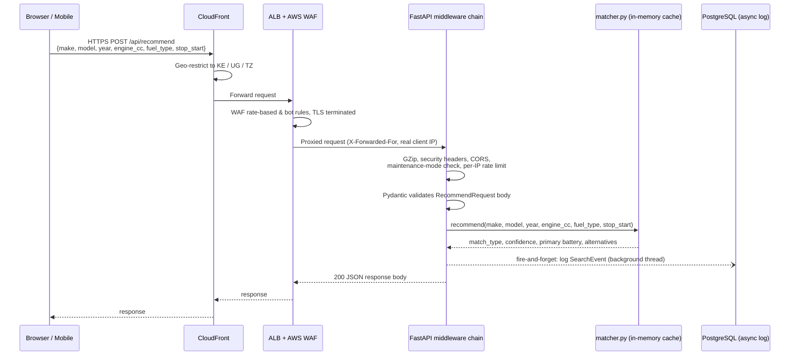
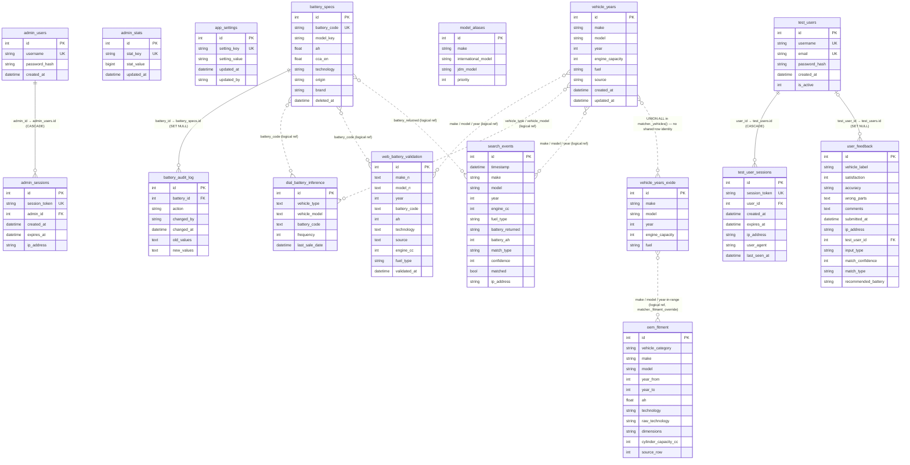

# Chloride Exide KE — Battery Finder

Chloride Exide KE Battery Finder is a production web application that helps Eastern African Drivers (Kenya Uganda & Tanzania ) drivers and service centres identify the correct battery for any vehicle in the local market. It is built on a cleaned and enriched CRSP/NTS dataset covering tens of thousands of make-model-year combinations, extended with engine capacity and fuel type data sourced from fueleconomy.gov, NHTSA VPIC, CarAPI, Wikipedia, and Wikidata, and further widened by Exide's own official global fitment guide (a separate table, curated down to Kenya/UG/TZ-relevant makes) which also supplies a precise Ah spec that overrides the engine-CC rule-of-thumb wherever available (technology preference still follows this app's own luxury-make/stop-start rules).

The system is organized into three layers. The data pipeline layer normalises raw CRSP vehicle records, resolves production year gaps through multi-source API enrichment, ingests real-world Dial-A-Battery call-centre order history, cleans and filters Exide's own fitment guide down to market-relevant makes, and stages all changes for admin review before they are committed to the live dataset. The backend is a FastAPI server running a five-layer matching engine that resolves a vehicle query against web-validated fitment data, real-world sales history, exact dataset matches, fuzzy close matches, and engine-CC rule-based fallback — with Exide's own fitment spec substituted in as the Ah source whenever available (technology preference is untouched, always following this app's own luxury-make/stop-start rules), regardless of which layer resolved the vehicle — returning a primary battery recommendation with confidence score, match type, `ah_source`, and a list of alternatives. The frontend is a React 19 + TypeScript application built with Vite and Tailwind CSS v4, with a full admin dashboard for managing the battery catalogue, reviewing pipeline output, browsing vehicle-data coverage, monitoring search logs and user feedback, and inspecting audit history.

The application is geo-restricted to Kenya, Uganda and Tanzania served entirely from a single FastAPI process in production — the built frontend is served as static files alongside the API.

---

## Table of Contents

- [Tech Stack](#tech-stack)
- [Project Structure](#project-structure)
- [Getting Started](#getting-started)
- [Running the App](#running-the-app)
- [Testing on a Real Device](#testing-on-a-real-device)
- [Mobile Experience](#mobile-experience)
- [API Reference](#api-reference)
- [Matching Engine](#matching-engine)
- [Admin Dashboard](#admin-dashboard)
- [Data Pipelines](#data-pipelines)
- [Database Schema](#database-schema)
- [Performance](#performance)
- [Security](#security)
- [Production Architecture](#production-architecture)
- [Environment Variables](#environment-variables)
- [CI/CD](#cicd)

---

## Tech Stack

### Backend
| Layer | Technology |
|---|---|
| Language | [Python 3.10+](https://www.python.org/) |
| Web framework | [FastAPI](https://fastapi.tiangolo.com/) (`app.py`) |
| ASGI server | [Uvicorn](https://www.uvicorn.org/) |
| Middleware | [GZip](https://www.starlette.io/middleware/#gzipmiddleware) · maintenance mode · read counter · cache control · [slowapi](https://github.com/laurentS/slowapi) rate limiting |
| Rate limiting | [slowapi](https://github.com/laurentS/slowapi) — per-endpoint limits (10/min recommend, 5/min feedback, 20/min dropdowns) |
| ORM | [SQLAlchemy 2.0](https://www.sqlalchemy.org/) (`db.py`, `models.py`) |
| Migrations | [Alembic](https://alembic.sqlalchemy.org/) (`alembic/`) |
| Data validation | [Pydantic 2](https://docs.pydantic.dev/) — request/response schemas across `app.py` and `admin_router.py` |
| Config | [python-dotenv](https://pypi.org/project/python-dotenv/) — loads `.env` in `db.py` (`override=False`, never clobbers real env vars injected by ECS) |
| Auth | [bcrypt](https://pypi.org/project/bcrypt/) + HttpOnly session cookies (`admin_auth.py`) |
| Database | [PostgreSQL](https://www.postgresql.org/) |
| DB driver | [psycopg2](https://www.psycopg.org/) — DBAPI adapter SQLAlchemy uses to talk to PostgreSQL |
| Local database (dev) | [Docker Compose](https://docs.docker.com/compose/) running `postgres:15` (`docker-compose.yml`, repo root) — pinned to match the production RDS engine version; see [Local Postgres (Docker)](#local-postgres-docker) |
| Fuzzy matching | [RapidFuzz](https://github.com/maxbachmann/RapidFuzz) — vehicle model name matching in `matcher.py` |
| File uploads | [python-multipart](https://github.com/Kludex/python-multipart) — multipart form parsing for battery Excel uploads |
| PDF export | [ReportLab](https://www.reportlab.com/) — admin battery catalogue PDF generation |

Full pinned list: [`backend/requirements.txt`](backend/requirements.txt).

### Frontend
| Layer | Technology |
|---|---|
| Framework | [React 19](https://react.dev/) + [TypeScript 6](https://www.typescriptlang.org/) |
| Build tool | [Vite 8](https://vite.dev/) |
| Package manager | [Bun](https://bun.sh/) |
| Styling | [Tailwind CSS v4](https://tailwindcss.com/) + inline `style={{}}` props |
| UI primitives | [Radix UI](https://www.radix-ui.com/) |
| Routing | [React Router v7](https://reactrouter.com/) |
| Icons | [Lucide React](https://lucide.dev/) + [Heroicons](https://heroicons.com/) |
| Country flags | [react-country-flag](https://www.npmjs.com/package/react-country-flag) — SVG flag icons in result card |
| Car brand logos | [car-logos-dataset](https://github.com/filippofilip95/car-logos-dataset) (MIT) via [jsDelivr](https://www.jsdelivr.com/) GitHub CDN — make picker in the admin Web Validate tab |
| Component variants | [class-variance-authority](https://cva.style/) + [clsx](https://github.com/lukeed/clsx) + [tailwind-merge](https://github.com/dcastil/tailwind-merge) |
| PDF export | [jsPDF](https://github.com/parallax/jsPDF) + [jspdf-autotable](https://github.com/simonbengtsson/jsPDF-AutoTable) — admin battery catalogue PDF generation |
| Linting | [ESLint 10](https://eslint.org/) + [typescript-eslint](https://typescript-eslint.io/) |
| Type checking | [TypeScript 6](https://www.typescriptlang.org/) (`tsc -b`) |
| Asset build | [sharp](https://sharp.pixelplumbing.com/) — image compression (`scripts/compress-assets.mjs`) |

Full pinned list: [`frontend/package.json`](frontend/package.json).

### Data Pipeline
| Tool | Purpose |
|---|---|
| [Pandas](https://pandas.pydata.org/) | Data cleaning, normalization, and output |
| [RapidFuzz](https://github.com/maxbachmann/RapidFuzz) | Fuzzy model name matching across external API results |
| [NHTSA VPIC API](https://vpic.nhtsa.dot.gov/api/) | Vehicle make/model lookup |
| [CarAPI](https://carapi.app/) | Year-range data per model |
| [fueleconomy.gov](https://www.fueleconomy.gov/) | US DOE/EPA bulk CSV (local cache) |
| [Wikidata](https://www.wikidata.org/) / [Wikipedia](https://www.wikipedia.org/) | Supplementary year and fuel-type enrichment |
| [duckduckgo-search](https://github.com/deedy5/duckduckgo_search) (`ddgs`) | Web battery validation pipeline |
| [Tavily](https://tavily.com/) | AI-powered web search — battery validation pipeline |
| [Requests](https://requests.readthedocs.io/) | HTTP client underlying all external API/scraping calls |
| [BeautifulSoup4](https://www.crummy.com/software/BeautifulSoup/) + [lxml](https://lxml.de/) | HTML parsing in `vehicle_coverage_expansion.py` |
| [openpyxl](https://openpyxl.readthedocs.io/) / [xlrd](https://pypi.org/project/xlrd/) | Excel (`.xlsx`/`.xls`) reading for CRSP and Dial-A-Battery source files |
| [NumPy](https://numpy.org/) | Numerical operations underpinning Pandas transforms |
| [Matplotlib](https://matplotlib.org/) / [Seaborn](https://seaborn.pydata.org/) | Charting in accuracy-report scripts (`scripts/generate_accuracy_report_hard_failure_modes_200.py`) |
| [Jupyter](https://jupyter.org/) / [ipykernel](https://github.com/ipython/ipykernel) | `scripts/analysis.ipynb` exploratory analysis notebook |

---

## Project Structure

```
├── backend/                     # All backend Python code
│   ├── app.py                   # FastAPI entrypoint — public API, auth, middleware
│   ├── admin_router.py          # All /api/admin/* routes (batteries, audit, sessions, pipelines)
│   ├── admin_auth.py            # bcrypt + HttpOnly cookie session management
│   ├── app_state.py             # In-process maintenance-mode flag
│   ├── matcher.py                # 5-layer battery matching engine
│   ├── models.py                # SQLAlchemy ORM models for all tables
│   ├── db.py                    # SQLAlchemy engine + SessionLocal factory
│   ├── upload_pipeline.py        # Battery spec upload/import handler
│   ├── requirements.txt          # Python dependencies
│   │
│   ├── alembic/                  # Database migration scripts
│   │   ├── env.py
│   │   └── versions/             # One migration file per schema change
│   │
│   ├── pipelines/                 # Data pipeline scripts (see Data Pipelines)
│   ├── scripts/                   # Standalone accuracy/admin/analysis scripts
│   ├── cache/                     # Enrichment cache files (safe to delete)
│   ├── data/                      # Source data files (e.g. Dial-A-Battery Excel)
│   ├── static/                    # Maintenance page + fallback static assets
│   └── uploads/                   # Uploaded battery/CRSP Excel files
│
├── frontend/                   # React + TypeScript frontend
│   ├── src/
│   │   ├── App.tsx             # Root layout — navbar, dark mode, routing, mobile detection
│   │   ├── components/
│   │   │   ├── VehicleFinderForm.tsx   # Desktop search form (Select/Type toggle)
│   │   │   ├── MobileVehicleFinder.tsx # Mobile step-wizard (Make→Model→Year→Details→Result)
│   │   │   ├── AccuracyBar.tsx         # Segmented match accuracy bar
│   │   │   ├── FeedbackModal.tsx       # User feedback submission drawer
│   │   │   ├── Notification.tsx        # Toast notification system
│   │   │   ├── PageLoader.tsx          # Animated battery splash screen
│   │   │   ├── TermsGate.tsx           # Terms & conditions acceptance gate
│   │   │   └── admin/
│   │   │       ├── AdminLayout.tsx     # Admin panel shell (sidebar nav)
│   │   │       └── ProtectedRoute.tsx  # Auth guard for admin routes
│   │   ├── pages/
│   │   │   ├── admin/
│   │   │   │   ├── AdminDashboard.tsx
│   │   │   │   ├── AdminBatteries.tsx
│   │   │   │   ├── AdminFeedback.tsx
│   │   │   │   ├── AdminAuditLog.tsx
│   │   │   │   ├── AdminSessions.tsx
│   │   │   │   ├── AdminTestSessions.tsx
│   │   │   │   ├── AdminVehicleData.tsx    # merged Core Dataset Coverage + OEM Fitment tabs
│   │   │   │   ├── AdminDataPipeline.tsx
│   │   │   │   ├── AdminSearchLog.tsx
│   │   │   │   └── AdminLogin.tsx
│   │   │   └── TestUserLogin.tsx
│   │   ├── lib/
│   │   │   ├── api.ts              # Typed fetch wrappers for public API
│   │   │   ├── adminApi.ts         # Typed fetch wrappers for admin API
│   │   │   ├── testUserApi.ts      # Test-user auth API helpers
│   │   │   ├── brandBranding.ts    # Shared brand logo/color resolution (AdminBatteries + AdminDashboard)
│   │   │   ├── utils.ts            # cn() + useIsMobile() hook
│   │   │   └── TestUserContext.tsx # React context for test-user session state
│   │   └── types/
│   │       └── battery.ts          # TypeScript interfaces for API responses
│   ├── package.json
│   ├── vite.config.ts
│   └── tsconfig.app.json
│
├── docker-compose.yml           # Local Postgres 15 (matches RDS engine version)
├── Jenkinsfile                  # CI/CD pipeline definition
└── .env                         # Environment variables (not committed)
```

Backend `pipelines/` contains: `dataprep.py` (Pipeline 1: CRSP Excel → `vehicles_raw`), `enrich_years.py` (Pipeline 2: production-year enrichment), `dial_battery_clean.py` (Pipeline 3: Dial-A-Battery inference), `web_battery_validate.py` (internet fitment validation, run from the admin UI's Web Validate tab), `vehicle_coverage_expansion.py` (supplementary make/model/year coverage beyond the CRSP catalogue, run from the admin UI's Expansion tab), and `exide_fitment_clean.py` (Pipeline 6: Exide's own global fitment guide, cleaned and filtered to Kenya/UG/TZ-relevant makes). See [Data Pipelines](#data-pipelines) for details.

---

## Getting Started

### Prerequisites

- Python 3.10 or later
- [Bun](https://bun.sh/) (for frontend builds)
- PostgreSQL running and accessible (see [Local Postgres (Docker)](#local-postgres-docker) for a one-command option)
- `.env` file configured (see [Environment Variables](#environment-variables))

### Local Postgres (Docker)

A `docker-compose.yml` at the repo root runs a local Postgres pinned to the same engine version as production RDS (PostgreSQL 15), so migrations and queries that pass locally behave the same way in production. **This is the primary local Postgres for this project.**

```bash
docker compose up -d
```

This starts Postgres on `localhost:5434` (not 5432 — see the comment in `docker-compose.yml`: a native Postgres install commonly already owns 5432 on Windows, and Docker Desktop would otherwise silently bind the container's side on IPv6 instead of erroring, splitting `localhost:5432` across two different databases depending on which address family a client resolves first) with a named volume (`battery_finder_pgdata`) so data survives container restarts. Defaults (`batteryfinder` / `batteryfinder` / `batteryfinderdev`) match the example `.env` below — use it as-is and it works out of the box, or override via `POSTGRES_USER` / `POSTGRES_PASSWORD` / `POSTGRES_DB` / `POSTGRES_PORT` env vars if you point `DATABASE_URL` at different credentials.

```bash
docker compose down       # stop the container, keep data
docker compose down -v    # stop and wipe the volume for a clean slate
```

If you have an existing local Postgres install with real data (e.g. from before this project moved to Docker), migrate it in once:

```bash
# Dump from your existing Postgres (adjust host/port/user/db to match)
pg_dump -h 127.0.0.1 -p 5432 -U <user> -d <db> --no-owner --no-acl --no-comments -F p -f dump.sql

# pg_dump from a newer major version can emit syntax the container's
# Postgres 15 doesn't recognize (e.g. Postgres 18's `\restrict` and
# `transaction_timeout`) — strip those lines before restoring
grep -vF '\restrict' dump.sql | grep -vF '\unrestrict' | grep -vF 'SET transaction_timeout' > dump_clean.sql

# Restore into the (empty) Docker Postgres
cat dump_clean.sql | docker exec -i battery-finder-postgres psql -U batteryfinder -d batteryfinderdev -v ON_ERROR_STOP=1
```

### Set Up Python Virtual Environment

```bash
# Create the virtual environment (first time only)
python -m venv .venv

# Activate it — PowerShell
.venv\Scripts\Activate.ps1

# Activate it — bash / Git Bash
source .venv/Scripts/activate
```

> You must activate the virtual environment in every new terminal session before running `uvicorn`, `python`, or `alembic`.

### Install Dependencies

```bash
# Python (with .venv active) — all backend code lives in backend/
cd backend && pip install -r requirements.txt

# Frontend
cd frontend && bun install
```

### Apply Database Migrations

```bash
cd backend && alembic upgrade head
```

### Create First Admin User

```bash
cd backend && python scripts/create_admin.py --username admin --password yourpassword
```

Use `--force` to update an existing password:

```bash
python scripts/create_admin.py --username admin --password newpassword --force
```

---

## Running the App

### Production

```bash
# Build the frontend
cd frontend && bun run build && cd ..

# Start the backend (serves built frontend from frontend/dist/)
source .venv/Scripts/activate   # or .venv\Scripts\Activate.ps1 on PowerShell
cd backend && uvicorn app:app --host 0.0.0.0 --port 8000 --proxy-headers --forwarded-allow-ips="*"
```

The app starts on **http://localhost:8000**. Static frontend assets are served directly from `frontend/dist/` by FastAPI.

`--proxy-headers --forwarded-allow-ips="*"` is required in production: the app runs behind an ALB (see Production Architecture below), so without it every request's `request.client.host` is the ALB's own IP rather than the real client's, which silently collapses slowapi's per-client rate limits into one shared bucket for all users. `--forwarded-allow-ips="*"` is safe here because ECS Fargate tasks are only reachable via the ALB — there is no direct public path to the container that could spoof `X-Forwarded-For` from outside.

### Development (hot reload)

```bash
# Terminal 1 — backend (port 8000)
source .venv/Scripts/activate
cd backend && uvicorn app:app --reload

# Terminal 2 — frontend (port 5173, proxies /api to port 8000)
cd frontend && bun run dev
```

Frontend dev server: **http://localhost:5173**

---

## Testing on a Real Device

To test the mobile wizard on your phone during development, expose the Vite dev server via ngrok. Vite's proxy handles `/api` forwarding server-side so only one tunnel is needed.

```bash
# Terminal 1 — backend
cd backend && uvicorn app:app --reload

# Terminal 2 — frontend
cd frontend && bun run dev

# Terminal 3 — tunnel
ngrok http 5173
```

Open the ngrok HTTPS URL on your phone. The mobile wizard activates automatically at screen widths ≤ 600 px.

> **Note:** Geo-restriction (Kenya, Uganda, Tanzania) is enforced at the CloudFront edge in production, not in the app itself — a local `uvicorn` + ngrok setup bypasses CloudFront entirely, so there's no geo-gate to hit here regardless of your ngrok exit node's location.

---

## Mobile Experience

On screens ≤ 600 px wide (phones), the app renders a dedicated **step-by-step wizard** (`MobileVehicleFinder.tsx`) instead of the desktop form. The desktop UI (`VehicleFinderForm.tsx`) is completely unchanged.

### Wizard Flow

```
Step 1: Select Make  →  Step 2: Select Model
→  Step 3: Select Year  →  Step 4: Engine Details (optional)
→  Result screen
```

- **Auto-advance** — selecting a Make immediately fetches models and advances to Step 2. Selecting a Model immediately fetches years and advances to Step 3.
- **Year** requires an explicit "Continue" tap to prevent accidental advances.
- **Engine Details** (fuel type + CC) are optional; a "Skip & Find Battery" button proceeds without them.
- **Result screen** shows: vehicle label, primary battery (Ah, CCA, code with copy button), result accuracy bar, Rate / Shop Now buttons, Dial-a-Battery numbers, collapsible same-tech alternatives, and a "Search Again" reset button.
- Dark mode is fully supported — CSS variables apply automatically.

### Breakpoint

| Width | Experience |
|---|---|
| ≤ 600 px | Mobile wizard (`MobileVehicleFinder`) |
| > 600 px | Desktop form (`VehicleFinderForm`) |

Detection is done client-side via `useIsMobile()` in `frontend/src/lib/utils.ts`, which uses `window.matchMedia` and responds to resize events.

---

## API Reference

All public endpoints are rate-limited and served under `/api/`.

### Request Lifecycle

How a single `POST /api/recommend` call travels from a user's browser or mobile device, through the API middleware chain and matching engine, and back as a response body. Static asset requests (the built SPA) short-circuit at CloudFront to S3 and never reach this path — see [Production Architecture](#production-architecture).



### Public Endpoints

| Method | Endpoint | Rate Limit | Description |
|---|---|---|---|
| `GET` | `/api/makes` | 20/min | List all available vehicle makes |
| `GET` | `/api/models/{make}` | 20/min | List models for a given make |
| `GET` | `/api/years?make=&model=` | 20/min | List available years for a make + model |
| `POST` | `/api/recommend` | 10/min | Get a battery recommendation |
| `POST` | `/api/feedback` | 5/min | Submit feedback on a recommendation |
| `POST` | `/api/battery-search` | 10/min | Search batteries by Ah and/or CCA spec |

`GET /health` (outside `/api/`, 60/min) is a separate unauthenticated liveness/readiness check meant for the ALB target group — the only other health route, `GET /api/admin/health`, is gated behind admin auth, so an ALB pointed at anything under `/api/` would always get 401 and deregister healthy tasks. Returns only `{"status": "ok"/"down"}` after a real `SELECT 1`; the latency/pool-usage diagnostics stay behind the admin-gated route. **Confirm the ALB target group's health-check path is actually pointed at `/health`** (not `/` or something under `/api/admin`) — that's an AWS console/IaC change outside this repo.

### Auth Endpoints (Test Users)

| Method | Endpoint | Rate Limit | Description |
|---|---|---|---|
| `POST` | `/api/auth/register` | 5/min | Register a new test user |
| `POST` | `/api/auth/login` | 10/min | Log in as a test user |
| `POST` | `/api/auth/logout` | — | Log out |
| `GET` | `/api/auth/me` | — | Get current test user info |

### `POST /api/recommend` — Request Body

```json
{
  "make": "TOYOTA",
  "model": "Corolla",
  "year": 2015,
  "engine_cc": 1500,
  "fuel_type": "Petrol",
  "stop_start": true
}
```

`engine_cc` (500–8000), `fuel_type`, and `stop_start` are optional but improve match confidence.

### `POST /api/recommend` — Response

```json
{
  "match_type": "Exact Match",
  "confidence": 100,
  "matched_make": "TOYOTA",
  "matched_model": "COROLLA AXIO G",
  "matched_year": 2015,
  "engine_cc": 1500,
  "fuel_type": "PETROL",
  "battery_region": "NS",
  "recommended_ah": 45,
  "preferred_tech": "MF",
  "ah_source": "oem_fitment",
  "primary": {
    "battery_code": "NS60",
    "model_key": "NS60",
    "ah": 45,
    "cca_en": 390,
    "technology": "MF",
    "origin": "imported"
  },
  "alternatives": []
}
```

---

## Matching Engine

Defined in `matcher.py`. All data sources are loaded from the database at startup via `@lru_cache` and held in memory for fast lookups. Cache can be flushed from the admin dashboard.

### Layer Overview

| Priority | Layer | Data Source | Confidence |
|---|---|---|---|
| 0a | **Web Validation** | `web_battery_validation` — internet-sourced fitment data | 75–90% |
| 0b | **Real-World Inference** | `dial_battery_inference` — Dial-A-Battery historical orders | 80–95% |
| 1 | **Exact Match** | `vehicle_years` — fuzzy model ≥ 90 + exact year | 100% |
| 2 | **Soft Match** | `vehicle_years` — fuzzy model ≥ 60 + year within ±3 | 60–89% |
| 3 | **Rule-Based Fallback** | Engine CC + fuel → Ah bracket table | 40% |

Layers 1/2/3 query `matcher._vehicles()`, which is a `UNION ALL` of `vehicle_years` and `vehicle_years_exide` (make/model/year rows exploded from Exide's fitment guide — see [OEM Fitment Override](#oem-fitment-override) below) — so vehicles that only exist in Exide's global catalog are just as matchable as ones sourced from fueleconomy.gov/NHTSA/etc., without either table needing to know about the other.

Aliases (`model_aliases`) are applied between layers 1/2 and 3 to map international model names (e.g. "Civic") to their JDM dataset equivalents (e.g. "CIVIC FERIO").

### OEM Fitment Override

`oem_fitment` (Exide's own official global fitment guide — see [Pipeline 6](#pipeline-6--exide-fitment-guide)) is **not** a sixth matching layer and never affects which layer resolves the vehicle or its confidence score. Instead, once *any* of the layers above has resolved a `(make, model, year)`, `matcher._fitment_override()` checks `oem_fitment` for a row covering that same vehicle (exact or fuzzy model match, year within the row's `[year_from, year_to]` range). If found, its **Ah replaces** whatever that layer would otherwise have used — including overriding a Layer 0a/0b confirmed-battery-code Ah — since Exide's own spec sheet is treated as the most trustworthy source whenever it's available. The response's `ah_source` field records which path actually supplied the number: `"oem_fitment"`, `"battery_code"` (0a/0b's normal path), or `"cc_bracket_estimate"` (1/2/3's normal path).

**Technology preference is deliberately NOT taken from `oem_fitment`.** Many of its technology values are Exide product-tier names (`PREMIUM`, `CLASSIC`, `START PRO`, ...) rather than actual battery chemistry, and even where it is a real chemistry value, this app's own luxury-make/stop-start rules must keep deciding `preferred_tech` — luxury makes always prefer AGM (falling back to whatever `_select_batteries()` finds best-stocked at that Ah if no AGM exists, normally EFB), and stop-start vehicles prefer EFB/AGM per `_preferred_tech()` — rather than deferring to Exide's per-vehicle tech column, which doesn't know about local stock or this app's brand-tier policy. `preferred_tech` is computed *before* `_fitment_override()` runs and is passed into it — used only to pick between tiers (below), never overwritten by it.

**Picking among multiple tiers for the same vehicle.** A single make/model/year-range in `oem_fitment` commonly has several rows — Exide lists multiple battery tiers for the same trim, e.g. a base `50Ah/MF` option alongside `55Ah/EFB` and `60Ah/EFB` upgrades. This is legitimate data, not duplicates (see `OemFitment`'s unique constraint in [Database Schema](#database-schema)). When more than one tier matches the resolved model/year, `_fitment_override()` prefers whichever tier's `technology` matches the `preferred_tech` already decided above, and only falls back to the highest Ah across *all* tiers when none match. This keeps the Ah figure paired with a technology Exide actually offered together — e.g. for that Abarth Grande Punto, a non-stop-start match resolves to `50Ah`/`MF` while a stop-start match resolves to `60Ah`/`EFB`, rather than always taking the highest listed Ah (`60`) regardless of which technology this app is actually about to sell.

**Alternatives still come from the main catalogue either way.** The override only changes the `target_ah` *input* to `_select_batteries()` (`preferred_tech` is untouched by the override — see above) — every code path (all three `_select_batteries()` call sites in `matcher.py`) calls that same function afterward, which always queries `battery_specs` for the primary battery and up to 6 alternatives (same Ah, same CCA, same technology as primary). Falling into the OEM fitment route doesn't swap in a different alternatives source or skip alternatives — it just makes the Ah target that `_select_batteries()` searches around more precise.

### Flowchart


### Fuzzy Model Scoring

The same base model (e.g. "COROLLA") can exist in the dataset as dozens of distinct trims ("COROLLA AXIO G", "COROLLA FIELDER X", ...), and users rarely type the full trim name. `_fuzzy_model_score_for_year()` decides which stored trim a typed model name actually refers to.

It tries three RapidFuzz scoring methods in order, from most to least strict, and stops at the first one that produces a usable match:

1. **`partial_ratio`** (score ≥ 80, only for queries of 4+ characters) — checks whether the typed text appears as a prefix/substring of the candidate name. This is what lets "COROLLA" match "COROLLA AXIO G". Short queries are excluded here because a 2-3 letter substring would match almost anything.
2. **`token_set_ratio`** (score ≥ 72) — compares the *set* of words in each name, ignoring order and duplicates, so it still scores well when the query and candidate share some words but not all — e.g. "MARCH ACTIVE" matching "MARCH G" (both share "MARCH", even though the trim word differs).
3. **`WRatio`** (score ≥ 60) — a general-purpose blended score RapidFuzz derives from several comparison methods at once. Used only as a last-resort fallback when the two more targeted methods above find nothing.

Whichever method finds candidates, the single highest fuzzy score isn't the deciding factor — several real trims often land at nearly the same score, and the top-scoring one isn't always the one actually sold in the year the user asked about. Instead, among candidates that clear the threshold, the matcher picks in this priority order:

1. **Prefix match** — does the candidate genuinely start with the words the user typed?
2. **Exact year** — does that candidate exist in the dataset for the exact year requested?
3. **Closest year** — if not exact, which candidate's nearest recorded year (within ±3 years) is closest?
4. **Fuzzy score** — only used as the final tiebreaker once the above are equal.

This ordering is why the matcher reliably lands on the correct year's trim instead of a different-year trim that happened to score marginally higher on text similarity alone.

### Ah Bracket Rules

| Engine CC | Petrol (Ah) | Diesel (Ah) | Hybrid (Ah) |
|---|---|---|---|
| ≤ 1000 | 35 | 40 | 35 |
| ≤ 1600 | 45 | 50 | 45 |
| ≤ 2000 | 55 | 65 | 55 |
| ≤ 2500 | 70 | 80 | 65 |
| ≤ 3000 | 80 | 90 | 80 |
| ≤ 4000 | 90 | 100 | 90 |
| > 4000 | 100 | 120 | 100 |

Year modifier applied on top: `< 2000 → −5` · `2000–2011 → 0` · `2012–2017 → +5` · `≥ 2018 → +10`.

### Result Accuracy Bar

The result card renders a segmented accuracy bar (`AccuracyBar.tsx`) with four independently scored factors:

| Segment | Max | Color | Scoring |
|---|---|---|---|
| Car Found | 50 pts | Green | 50 for exact/real-world; 20–40 for close; 0 for fallback |
| Year | 25 pts | Blue | 25 exact; decreasing with delta; 0 if > 3 years off |
| Data Quality | 15 pts | Violet | 15 real-world source; 12 model found; 4 fallback |
| Engine Info | 10 pts | Amber | 10 model matched; 6 CC provided; 2 otherwise |

Total (0–100) shown as a percentage with a 0.7 s ease-out fill animation.

---

## Admin Dashboard

Protected under `/api/admin/*`. Access requires an HttpOnly session cookie issued by `POST /api/admin/login`.

### Pages

| Page | Route | Description |
|---|---|---|
| Dashboard | `/admin` | Live stats, match breakdown card, health indicator. Cards animate in with staggered slide-in on load. Auto-refreshes every 15 minutes. **Makes & Models** card shows Core Dataset / OEM Fitment entry counts side by side with a combined total, plus core/fitment pairs in the footer. **Battery Records** card shows the active total, a Local/Imported origin split, an MF/EFB/AGM/Flooded technology-mix line, and small logo thumbnails for featured brands (Powerlast, Sebang, Chloride Exide AGM). |
| Battery Specs | `/admin/batteries` | Brand tile overview (with orbital loader), brand detail table, full search/filter/paginate table. CRUD and bulk Excel upload available in manage mode. |
| Search Log | `/admin/search-log` | Paginated table of every `/api/recommend` call: vehicle, input, battery returned, match type, confidence, IP. Download PDF exports a full branded A4 report (jsPDF, lazy-loaded). |
| Feedback | `/admin/feedback` | All user-submitted feedback with rating, accuracy, match metadata. Rows animate in staggered on load. |
| Audit Log | `/admin/audit` | Immutable history of every battery spec create/update/delete. |
| Sessions | `/admin/sessions` | Active admin sessions with revoke. |
| Data Pipeline | `/admin/data-pipeline` | Three tabs: **CRSP Pipeline** (run `dataprep.py`, stream stage progress, review output summary, then Staging Review to commit to `vehicle_years`), **Web Validate** (run `web_battery_validate.py` — toggle providers, choose phase, monitor live progress with pause/resume/cancel, fix suspicious Ah values, resolve conflicts, commit to master), **Expansion** (run `vehicle_coverage_expansion.py` to widen make/model/year coverage beyond the CRSP catalogue). Exide fitment ingestion (`exide_fitment_clean.py`) is CLI-only and has no tab here — see [Pipeline 6](#pipeline-6--exide-fitment-guide). |
| Vehicle Data | `/admin/vehicle-data` | Two tabs, replacing the old separate Coverage page: **Core Dataset Coverage** (web-validation match %, coverage-by-make, paginated matched/unmatched vehicle tables — the full former Coverage page content, unchanged) and **OEM Fitment** (searchable paginated browse of `oem_fitment`: make, model, year range, Ah, technology, dimensions, cylinder CC). |

### API Endpoints

| Method | Endpoint | Description |
|---|---|---|
| `POST` | `/api/admin/login` | Admin login (5/min) |
| `POST` | `/api/admin/logout` | Clear session |
| `GET` | `/api/admin/me` | Current admin user |
| `GET` | `/api/admin/stats` | Usage stats, table counts (including `oem_fitment`/`vehicle_years_exide` totals and pairs, and battery origin/technology breakdown), today's match breakdown (3 queries) |
| `GET` | `/api/admin/health` | Database connectivity + latency check, cluster-wide connection count (`pg_stat_activity`, ground truth across all ECS tasks) alongside this task's own pool usage |
| `GET/POST` | `/api/admin/batteries` | List (paginated) or create battery specs |
| `PATCH` | `/api/admin/batteries/{id}` | Update a battery spec |
| `DELETE` | `/api/admin/batteries/{id}` | Soft-delete a battery spec |
| `POST` | `/api/admin/batteries/upload` | Bulk upload from Excel |
| `GET` | `/api/admin/batteries/export` | Export battery specs as Excel |
| `GET` | `/api/admin/audit` | Full change history (paginated, filterable) |
| `GET` | `/api/admin/search-events` | Paginated search event log |
| `POST` | `/api/admin/cache/refresh` | Reload matcher caches from DB, including `_fitment()` (OEM fitment override data) |
| `GET/DELETE` | `/api/admin/sessions` | View or revoke admin sessions |
| `GET` | `/api/admin/vehicle-data/core` | Paginated, searchable browse of `vehicle_years` (Vehicle Data → Core Dataset Coverage tab underpinnings) |
| `GET` | `/api/admin/vehicle-data/oem-fitment` | Paginated, searchable browse of `oem_fitment` (Vehicle Data → OEM Fitment tab) |

### Search Event Logging

Every call to `POST /api/recommend` is logged asynchronously to `search_events` via a fire-and-forget background thread. No latency is added to the recommendation response.

Fields captured per event:

| Field | Source |
|---|---|
| `make`, `model`, `year` | Request body |
| `engine_cc`, `fuel_type` | Request body |
| `battery_returned`, `battery_ah` | `result["primary"]["battery_code"]` and `ah` |
| `match_type`, `confidence`, `matched` | Matcher result |
| `ip_address` | `X-Forwarded-For` header (proxy-safe, comma-split, 45-char clamp) |
| `timestamp` | UTC at time of request |

---

## Data Pipelines

Run scripts in order when refreshing the dataset. All pipeline scripts live in `backend/pipelines/` and are run with `backend/` as the working directory.

### Pipeline 1 — CRSP Data Prep

```bash
cd backend && python pipelines/dataprep.py
```

Input: `New-CRSP---July-2025.xlsx` (not committed)
Output: `battery_lookup_dataset.csv`

### Pipeline 2 — Year Enrichment

```bash
cd backend && python pipelines/enrich_years.py
```

Fetches production years from (in order): fueleconomy.gov bulk CSV → NHTSA VPIC → CarAPI → Wikidata/Wikipedia.
Results cached in `backend/cache/year_cache.json` and `backend/cache/fueleconomy_vehicles.csv`. Safe to delete to force a full re-fetch.

### Pipeline 3 — Dial-A-Battery Inference

```bash
cd backend && python pipelines/dial_battery_clean.py
```

Input: `backend/data/Dial-A-Battery Data - 2023-2026.xlsx`
Output: `dial_battery_inference` table

### Pipeline 4 — Web Battery Validation

Normally run from the admin UI (`/admin/data-pipeline` → Web Validate tab), which adds pause/resume/cancel controls and a staging review step. Can also run standalone:

```bash
cd backend && python pipelines/web_battery_validate.py
```

Queries external sources (SearXNG → DuckDuckGo → Brave → Tavily, in order) for the internet-accepted battery on each `(make, model, year)` combination not already in `web_battery_validation`. See [Environment Variables](#environment-variables) for the optional provider keys (`SEARXNG_URL`, `BRAVE_SEARCH_API_KEY`, `TAVILY_API_KEY`) — any source without a key/URL configured is simply skipped.
Output: `web_battery_validation` table (via `web_battery_staging` review)

### Pipeline 5 — Vehicle Coverage Expansion

Supplementary pipeline that widens `vehicle_years` beyond the CRSP catalogue for Kenya-relevant makes underserved by fueleconomy.gov, using NHTSA VPIC, CarQuery, and two scrapers (cars-data.com, car.info). Normally run from the admin UI (`/admin/data-pipeline` → Expansion tab); can also run standalone:

```bash
cd backend && python pipelines/vehicle_coverage_expansion.py [--makes toyota,nissan,...] [--years 1990-2026]
```

`engine_capacity` and `fuel` are left `NULL` for these rows — the matcher's exact/soft-match layers only need make/model/year.
Output: `vehicle_years_staging` (same staging → commit workflow as the CRSP pipeline)

### Pipeline 6 — Exide Fitment Guide

CLI-only, no admin UI trigger (mirrors Pipeline 3's precedent) — run whenever Exide sends an updated global fitment catalog:

```bash
cd backend && python pipelines/exide_fitment_clean.py
```

Input: `EXIDE BATTERY FINDER - <date>.xlsx` at the repo root (two sheets: `PASSENGER CARS`, `COMMERCIAL VEHICLES`) — **not committed to git**; place a copy at the repo root before running.

Cleans a genuinely messy global source file: fixes a ~40% Ah/Type column swap on the passenger sheet (detected per-row — whichever cell is numeric is Ah), parses inconsistent year-range strings (`"2016- PRESENT"`, `"1989-2007"`, etc.) with sanity bounds to reject data-entry garbage, strips redundant make-prefixes and trailing chassis-code suffixes from model names, canonicalizes make spelling (aliases regional divisions like `FORD USA`/`FORD AUSTRALIA` into `FORD`, `KG MOBILITY` into `SSANGYONG`, etc.), and — the biggest cut — **filters out makes with no realistic Kenya/Uganda/Tanzania presence** (farm equipment, foreign buses/coaches, foreign heavy-haulage trucks, defunct/vintage brands, hypercars, microcars, and obscure Chinese/EV brands with no local import channel), taking the global catalog from 365 distinct makes down to a curated ~76.

Writes two tables, both fully `TRUNCATE`+reloaded on every run (idempotent, matches Pipeline 3's pattern) — **`vehicle_years` itself is never written to**:

- `oem_fitment` — Ah/technology fitment specs, kept as year-ranges (not exploded). Read by `matcher._fitment_override()` (see [OEM Fitment Override](#oem-fitment-override)).
- `vehicle_years_exide` — make/model/year existence rows, exploded from those ranges so they're searchable. Unioned into `matcher._vehicles()` alongside `vehicle_years`, never merged into it directly — see [Layer Overview](#layer-overview).

After running, restart the app or hit `POST /api/admin/cache/refresh` to pick up the new data — there's no automatic reload.

---

## Database Schema

Managed by Alembic (`backend/alembic/versions/`). Apply all migrations with `alembic upgrade head` from `backend/`.

### Table Overview

| Table | Written by | Read by | Description |
|---|---|---|---|
| `vehicles_raw` | `dataprep.py` | pipelines | Cleaned CRSP vehicle records |
| `vehicle_years` | `enrich_years.py` | `matcher.py` | Per-make/model/year rows with CC + fuel |
| `vehicle_years_staging` | `enrich_years.py` / `vehicle_coverage_expansion.py` | admin UI | Enriched rows pending admin review |
| `vehicle_years_versions` | admin UI | admin UI | One record per approved merge commit |
| `vehicle_years_changelog` | admin UI | admin UI | Row-level diffs for rollback |
| `vehicle_years_unmatched` | `enrich_years.py` | admin UI | Models that failed year enrichment |
| `vehicle_years_exide` | `exide_fitment_clean.py` | `matcher.py` (unioned with `vehicle_years`) | Make/model/year existence rows exploded from Exide's fitment guide — `vehicle_years` itself is never written to |
| `oem_fitment` | `exide_fitment_clean.py` | `matcher.py` | Exide's Ah/technology fitment specs, kept as year-ranges — see [OEM Fitment Override](#oem-fitment-override) |
| `battery_specs` | admin upload | `matcher.py` | Battery catalogue (soft-delete via `deleted_at`) |
| `battery_audit_log` | `admin_router.py` | admin UI | Immutable change history |
| `model_aliases` | one-time import | `matcher.py` | International → JDM model name mappings |
| `dial_battery_inference` | `dial_battery_clean.py` | `matcher.py` | Real-world call-centre order data |
| `web_battery_validation` | `web_battery_validate.py` | `matcher.py` | Internet-validated fitment data |
| `web_battery_staging` | `web_battery_validate.py` | admin UI | Web validation rows pending review |
| `web_battery_validation_versions` | admin UI | admin UI | One record per approved web validation commit |
| `web_battery_validation_changelog` | admin UI | admin UI | Row-level diffs |
| `enrichment_cache_meta` | pipelines | admin UI | Cache download timestamps for external sources |
| `pipeline_run_log` | `web_battery_validate.py` | admin UI | Web validation run history |
| `fueleconomy_vehicles` | `enrich_years.py` | pipelines | fueleconomy.gov vehicle cache |
| `api_usage_quota` | pipelines | admin UI | Per-provider API call quotas (30-day rolling) |
| `admin_users` | `create_admin.py` | `admin_auth.py` | Admin credentials (bcrypt, cost 12) |
| `admin_sessions` | `admin_auth.py` | `admin_auth.py` | Active admin sessions (8-hour TTL) |
| `search_events` | `app.py` (`/api/recommend`) | admin UI | Append-only log of every battery recommendation request |
| `admin_stats` | `app.py` middleware | admin UI | Persisted usage counters |
| `app_settings` | admin UI | app | Key-value runtime configuration |
| `test_users` | `/api/auth/register` | `app.py` | Test user accounts |
| `test_user_sessions` | `/api/auth/login` | `app.py` | Test user tokens (24-hour TTL) |
| `user_feedback` | `/api/feedback` | admin UI | User feedback on recommendations |

### Core App Tables

Solid lines (`--`) are enforced foreign keys. Dashed lines (`..`) are logical references by value (no DB-level FK).



### Pipeline & Staging Tables

Solid lines (`--`) are enforced foreign keys. Dashed lines (`..`) show pipeline data flow (no DB-level FK).

```mermaid
erDiagram
    vehicles_raw {
        int id PK
        string make
        string model
        string model_number
        int engine_capacity
        string fuel
    }
    vehicle_years {
        int id PK
        string make
        string model
        int year
        int engine_capacity
        string fuel
        string source
    }
    vehicle_years_staging {
        int id PK
        text run_id
        string make
        string model
        int year
        int engine_capacity
        string fuel
        string source
        bool is_valid
        bool conflict
        text conflict_detail
        datetime staged_at
    }
    vehicle_years_versions {
        text id PK
        int version_number
        datetime committed_at
        text run_id
        int committed_count
        int updated_count
        int removed_count
        string committed_by
        string initiated_by
    }
    vehicle_years_changelog {
        int id PK
        text version_id FK
        string make
        string model
        int year
        text change_type
        text old_values
        text new_values
    }
    vehicle_years_unmatched {
        int id PK
        text run_id
        string make
        string model
        string fuel
        datetime recorded_at
    }
    web_battery_validation {
        int id PK
        text make_n
        text model_n
        int year
        text battery_code
        text run_id
        text version_id
    }
    web_battery_staging {
        int id PK
        text run_id
        text make_n
        text model_n
        int year
        text battery_code
        int ah
        text technology
        bool is_valid
        bool conflict
        datetime staged_at
    }
    web_battery_validation_versions {
        text id PK
        int version_number
        datetime committed_at
        text run_id
        int committed_count
        int removed_count
        text committed_by
        text initiated_by
    }
    web_battery_validation_changelog {
        int id PK
        text version_id FK
        text make_n
        text model_n
        int year
        text change_type
        text old_values
        text new_values
    }
    enrichment_cache_meta {
        text key PK
        datetime downloaded_at
        bigint file_size_bytes
        int record_count
        datetime updated_at
    }
    pipeline_run_log {
        int id PK
        text run_id
        text status
        datetime finished_at
        int combos_processed
        int combos_matched
    }
    fueleconomy_vehicles {
        int id PK
        int year
        string make
        string model
    }
    api_usage_quota {
        int id PK
        string provider
        string month
        int calls_made
        int quota_limit
        datetime period_start
        datetime period_end
    }

    vehicle_years_versions          ||--o{ vehicle_years_changelog          : "version_id → vehicle_years_versions.id (CASCADE)"
    web_battery_validation_versions ||--o{ web_battery_validation_changelog : "version_id → web_battery_validation_versions.id (CASCADE)"
    vehicles_raw                    }o..o{ vehicle_years                    : "dataprep.py produces"
    fueleconomy_vehicles            }o..o{ vehicle_years                    : "enrich_years.py populates from"
    vehicle_years_staging           }o..|| vehicle_years                    : "admin commit merges into"
    web_battery_staging             }o..|| web_battery_validation           : "admin commit merges into"
    web_battery_validation_versions |o..o{ web_battery_validation          : "version_id (run tracking)"
```



### Indexes

All indexes are created and dropped via Alembic migrations — never applied by hand.

#### `battery_specs`

| Index | Columns | Type | Purpose |
| --- | --- | --- | --- |
| `battery_specs_pkey` | `id` | Primary key | Row lookup |
| `battery_specs_battery_code_key` | `battery_code` | Unique | Upsert deduplication |
| `ix_battery_specs_model_key` | `model_key` | B-tree | Matcher model-key lookups |
| `ix_battery_specs_ah` | `ah` | B-tree | Ah-bracket queries |
| `ix_battery_specs_active` | `id WHERE deleted_at IS NULL` | Partial B-tree | Covers all admin list queries and matcher loader; only indexes active (non-deleted) rows |

#### `vehicle_years`

| Index | Columns | Type | Purpose |
| --- | --- | --- | --- |
| `vehicle_years_pkey` | `id` | Primary key | Row lookup |
| `uq_vehicle_years` | `(make, model, year)` | Unique | Prevents duplicate rows on pipeline re-import |
| `ix_vehicle_years_make` | `make` | B-tree | Filter by make (matcher, dropdowns) |
| `ix_vehicle_years_make_model` | `(make, model)` | B-tree | Composite filter used by matcher and model dropdown |

#### `vehicle_years_exide`

| Index | Columns | Type | Purpose |
| --- | --- | --- | --- |
| `vehicle_years_exide_pkey` | `id` | Primary key | Row lookup |
| `uq_vehicle_years_exide` | `(make, model, year)` | Unique | Prevents duplicate rows on pipeline re-run |
| `ix_vehicle_years_exide_make` | `make` | B-tree | Filter by make (matcher, dropdowns) |
| `ix_vehicle_years_exide_make_model` | `(make, model)` | B-tree | Composite filter used by matcher and model dropdown |

#### `oem_fitment`

| Index | Columns | Type | Purpose |
| --- | --- | --- | --- |
| `oem_fitment_pkey` | `id` | Primary key | Row lookup |
| `uq_oem_fitment` | `(make, model, vehicle_category, year_from, year_to, ah, technology)` | Unique | Allows multiple battery tiers per trim/year-range while preventing true duplicates on pipeline re-run |
| `ix_oem_fitment_make` | `make` | B-tree | Filter by make in `_fitment_override()` |
| `ix_oem_fitment_make_model` | `(make, model)` | B-tree | Composite filter used by `_fitment_override()` |

#### `search_events`

| Index | Columns | Type | Purpose |
| --- | --- | --- | --- |
| `search_events_pkey` | `id` | Primary key | Row lookup |
| `ix_search_events_timestamp` | `timestamp` | B-tree | `ORDER BY timestamp DESC` on search log page |
| `ix_search_events_match_type` | `match_type` | B-tree | Filter-by-match-type on search log page |

`search_events` also has `autovacuum_analyze_scale_factor = 0.05` set (default is 0.20), so Postgres re-analyzes it after every 5% growth rather than 20% — keeping planner statistics accurate as the append-only log scales.

#### `user_feedback`

| Index | Columns | Type | Purpose |
| --- | --- | --- | --- |
| `user_feedback_pkey` | `id` | Primary key | Row lookup |
| `ix_user_feedback_submitted_at` | `submitted_at` | B-tree | Date-ordered feedback listing |
| `ix_user_feedback_accuracy` | `accuracy` | B-tree | Filter-by-accuracy on feedback page |

---

## Performance

### Database Query Strategy

The app avoids N+1 query patterns through three mechanisms:

#### 1. Least Recent Used (LRU) In-memory matcher cache (hot path — zero DB queries per request)

`matcher.py` loads all batteries, vehicle years (a `UNION ALL` of `vehicle_years` and `vehicle_years_exide`), model aliases, web validations, Dial-A-Battery inference rows, and Exide's OEM fitment specs into memory at startup via `@lru_cache`. Every `/api/recommend` call runs entirely in memory. The cache can be flushed and reloaded from the admin dashboard without restarting the server.

A second, per-make layer (`matcher._make_index()`) sits on top of the full in-memory `vehicle_years` table: on a `recommend()` cache miss, `matcher.py` used to re-scan the entire table with a pandas boolean mask to find "all the Toyotas" (up to 3 times per call), and the fuzzy year-scorer re-filtered that slice again for every one of the ~60–80 candidate trims a scorer pass can return. `_make_index()` precomputes, once per make, the make-scoped row slice and a `model → sorted years sold` map, so both the outer make filter and the per-candidate year checks become dict/tuple lookups instead of repeated pandas scans. It's cleared alongside `_vehicles()` on the same manual cache-refresh action, since it derives from the same snapshot.

#### 2. Consolidated stats query (`GET /api/admin/stats`)

The dashboard stats endpoint previously issued 10–11 separate `COUNT` queries per call (one per table, one per match type bucket). It now runs 3 queries total:

| Before | After |
|---|---|
| 3 × `COUNT` on `dial_battery_inference` | 1 SQL with scalar subqueries (all table counts in one round trip — 19 as of the Exide fitment guide addition, up from the original 7; see `admin_router.py`'s `/stats` route for the full list) |
| 4 × ORM `COUNT` on separate tables | ↑ same query |
| 3 × `COUNT` on `search_events` (one per match type) | 1 `GROUP BY match_type` — Python buckets Matched / Close / Estimated |
| 1 × `AdminStats` lookup | 1 × `AdminStats` lookup (unchanged) |

```sql
-- All table counts in one query (abbreviated — 19 scalar subqueries total)
SELECT
    (SELECT COUNT(*) FROM battery_specs WHERE deleted_at IS NULL) AS battery_specs,
    (SELECT COUNT(DISTINCT make || '|' || model) FROM vehicle_years) AS vehicle_years,
    (SELECT COUNT(*) FROM vehicle_raw)         AS vehicles_raw,
    (SELECT COUNT(*) FROM model_aliases)       AS model_aliases,
    (SELECT COUNT(DISTINCT vehicle_type)  FROM dial_battery_inference) AS inf_makes,
    (SELECT COUNT(DISTINCT vehicle_model) FROM dial_battery_inference) AS inf_models,
    (SELECT COUNT(*) FROM dial_battery_inference)                      AS inf_records,
    -- ...and 12 more: oem_fitment/vehicle_years_exide totals + pairs,
    -- battery_specs origin (local/imported) and technology (MF/EFB/AGM/Flooded) breakdowns
```

```python
# One GROUP BY replaces three separate COUNT queries
rows = db.query(SearchEvent.match_type, func.count(SearchEvent.id))
         .filter(SearchEvent.timestamp >= today_start)
         .group_by(SearchEvent.match_type).all()
counts_by_type = {match_type: n for match_type, n in rows}
```

#### 3. Bulk pre-fetch in CRSP pipeline commit

When committing staged vehicle year rows to `vehicle_years`, all existing `(make, model, year)` keys are loaded into a Python `set` in one query before the loop. Each staging row is then checked via O(1) set membership — no per-row `SELECT`.

```python
# One query, O(1) lookup per row — no per-row SELECT
existing_keys = {
    (r.make, r.model, r.year)
    for r in db.execute(text("SELECT make, model, year FROM vehicle_years")).fetchall()
}
for row in staging_rows:
    if (row.make, row.model, row.year) in existing_keys:
        continue
```

#### 4. Matcher result cache (`recommend()`)

`matcher.recommend()` is decorated with `@lru_cache(maxsize=512)`, keyed on `(make, model, year, engine_cc, fuel_type, enable_aliases, stop_start)`. The first call for a given vehicle runs the full RapidFuzz matching logic; subsequent identical calls return the cached dict instantly. In production the most searched vehicles (Toyota Corolla, Honda Fit, Isuzu D-Max, etc.) are overwhelmingly repeat queries, so cache hit rates are high.

The cache is invalidated automatically whenever battery data changes — every battery create, update, delete, bulk upload, or admin cache refresh calls `matcher.recommend.cache_clear()` alongside the existing `matcher._batteries.cache_clear()`. Stale results are never served.

#### 5. Database indexes

Three indexes added via Alembic migration `3c4d5e6f7a8b`:

| Index | Table | Purpose |
| --- | --- | --- |
| `ix_search_events_match_type` | `search_events` | Covers the match_type filter on the Search Log admin page |
| `ix_battery_specs_active` | `battery_specs` | Partial index (`WHERE deleted_at IS NULL`) — only indexes active batteries; used by every admin list query and the matcher loader |
| `uq_vehicle_years` | `vehicle_years` | Unique composite `(make, model, year)` — prevents duplicates on pipeline re-import |

#### 6. VACUUM ANALYZE

Postgres does not overwrite rows when they are updated — it writes a new version alongside the old one and marks the old version dead. Dead rows accumulate between cleanup cycles, causing the query planner to work from stale statistics.

**VACUUM** removes dead row versions from disk. **ANALYZE** re-samples the table and updates the planner's row count and value distribution estimates so it can choose the right query plan (index scan vs. sequential scan).

This is **fully automatic** — no frontend button, no manual admin action. Postgres runs a background worker called autovacuum that fires VACUUM ANALYZE on each table once enough rows have changed. After the initial data import in June 2026 left 8,922 dead rows in `vehicle_years` and `search_events` had never been analyzed, a one-time manual `VACUUM ANALYZE` was run to clear the backlog immediately.

The migration also lowers the autovacuum sensitivity for `search_events`:

```sql
ALTER TABLE search_events SET (autovacuum_analyze_scale_factor = 0.05);
```

The default threshold is 20% — autovacuum only fires after 20% of the table's rows are new or updated. For an append-only log that grows steadily, this means planner statistics can lag far behind reality. Setting it to 5% means autovacuum re-analyzes `search_events` after every 5% growth, keeping query plans accurate as the table scales.

#### 7. Cluster-wide connection-pool visibility (`GET /api/admin/health`)

`engine.pool.checkedout()`/`.size()` are Python in-process numbers — with 2+ ECS Fargate tasks behind the ALB, each task has its own separate SQLAlchemy engine and pool, so whichever task happens to answer a given health-check request only knew about its own connections, not the real total open against RDS (e.g. 3 tasks each individually showing "6/25 (24%)" hid an actual 18/25 combined). The health endpoint now also queries Postgres directly — `SELECT count(*) FROM pg_stat_activity WHERE datname = current_database()` against `SELECT setting FROM pg_settings WHERE name = 'max_connections'` — for the ground-truth cluster-wide count, independent of which task serves the request. The admin dashboard's Database Health card shows this as the primary bar, with the existing per-task pool numbers underneath as a secondary "this instance" stat.

### Frontend Bundle Splitting

Vite is configured with manual chunk splitting (`vite.config.ts`) to separate vendor libraries and icon sets from application code. Heavy optional libraries (jsPDF, jspdf-autotable) are dynamically imported and only loaded when the PDF export button is clicked — they never appear in the initial bundle.

---

## Security

- **Secrets & configuration** — all credentials are loaded from environment variables via `python-dotenv` (`db.py`); in production, ECS injects real secrets from AWS SSM Parameter Store / Secrets Manager as environment variables, and `load_dotenv(override=False)` guarantees those always win over anything in a `.env` file — a stray `.env` baked into an image can never clobber a real secret
- **Password storage** — admin passwords are stored as bcrypt hashes with cost factor 12 (`admin_auth.py`); plaintext passwords are never logged or persisted. Cost 12 means bcrypt's key-schedule setup runs 2¹² (4,096) rounds per hash with a unique per-password salt — cheap enough for one real login, expensive enough to make brute-forcing a stolen hash set impractical
- **Session management** — admin sessions use cryptographically random 64-character hex tokens with an 8-hour server-side TTL; cookies are `HttpOnly`, `Secure`, `SameSite=Strict`, so they're inaccessible to JavaScript and never sent cross-site. Test-user sessions use bearer tokens (24-hour TTL) stored client-side instead of cookies
- **Revocable sessions** — `require_admin` (`admin_auth.py`) re-validates the session cookie against a database row on every request rather than trusting a self-contained signed token. That means an admin session can be invalidated immediately by deleting its row — there's no stateless-JWT-style window where a revoked session keeps working until it naturally expires
- **Session visibility & remote revocation** — the admin Sessions page lists every active admin session, and an endpoint (`admin_router.py`) lets an admin delete any of them on demand — so a suspicious or forgotten login can be killed from another device without waiting for its TTL
- **Cross-Site-Request-Forgery** **CSRF**— admin cookies are `HttpOnly` + `Secure` + `SameSite=Strict` (`admin_auth.py`), which already blocks the browser from attaching the session cookie to a cross-site request in any modern browser — the standard, sufficient CSRF defense for this app's threat model, without needing a separate token/double-submit scheme
- **Rate limiting** — per-endpoint limits enforced via `slowapi` (10/min recommend, 5/min feedback, 20/min dropdown lookups, 5/min auth endpoints), keyed off the real client IP. Production uvicorn runs with `--proxy-headers --forwarded-allow-ips="*"` so `request.client.host` is corrected from the ALB's `X-Forwarded-For` header — without this flag, every request behind the ALB reports the ALB's own IP, and all users would silently share one rate-limit bucket
- **Known limitation — IP rotation** — `slowapi`'s per-endpoint limits (and AWS WAF's rate-based rules) key their counters by client IP. An attacker spreading requests across many IPs (rotating proxies, a botnet) still gets a fresh bucket per IP, so neither layer alone meaningfully throttles a distributed attacker. For the highest-value target — admin login — there's a second, IP-independent layer: `admin_users.failed_login_attempts`/`locked_until` locks an account for 15 minutes after 8 consecutive failed attempts, tracked by username in the database (not in-memory, since 2+ Fargate tasks behind the ALB would each keep an inconsistent counter). This is deliberately targeted at login rather than a general CAPTCHA/behavioral-analysis system, which would be disproportionate for a single-admin-team internal dashboard; other endpoints remain IP-rotation-gameable by design
- **CORS** — an explicit `CORSMiddleware` (`app.py`) allowlists origins from `ALLOWED_ORIGINS` (empty by default — no origin is trusted unless configured) rather than `*`, with `allow_credentials=True` since admin auth uses cookies. CloudFront/ALB already serve the SPA and API same-origin in production, so this is defense-in-depth that makes the trust boundary explicit rather than implicit-by-topology
- **Security headers** — `X-Content-Type-Options: nosniff`, `X-Frame-Options: DENY`, `Referrer-Policy: strict-origin-when-cross-origin`, a restrictive `Permissions-Policy`, a `Content-Security-Policy` (verified against the actual built `frontend/dist` output — notably `style-src 'unsafe-inline'` for the frontend's inline `style={{}}` convention, and `img-src` allowlisting the jsdelivr CDN that `react-country-flag` fetches flag icons from), and `Strict-Transport-Security` when `ADMIN_COOKIE_SECURE` is true, so local HTTP dev isn't broken
- **Input validation** — every request body is validated against a Pydantic model before it reaches business logic, so malformed types or unexpected fields are rejected at the framework boundary rather than flowing into the database or matching engine
- **File upload validation** — both Excel upload routes (`admin_router.py`) reject anything but a `.xlsx`/`.xls` extension before the file is parsed; both the battery catalogue upload and the CRSP upload additionally cap the payload at 10MB so an oversized file is rejected before it's read into memory
- **Immutable audit trail** — `BatteryAuditLog` rows (old/new values as JSON) are only ever inserted or queried across the whole codebase — no route updates or deletes an existing entry, so it functions as a tamper-evident history of every admin change to the battery catalogue
- **SQL injection** — the app never builds a SQL statement by string-concatenating request input:
  - All runtime query paths in `app.py` and `admin_router.py` go through the SQLAlchemy ORM (`db.query(Model).filter(...)`), which compiles filters to parameterized statements — user input is always bound as a query parameter, never spliced into SQL text.
  - The handful of places that use raw `text()` SQL (e.g. the admin health check, staging-area lookups) still bind every value through named parameters (`:id`, `:lim`, `:off`, …); none of them format request data directly into the query string.
  - The one spot where an f-string assembles part of a query — the staging-area endpoint's `WHERE` clause in `admin_router.py` — only selects between a small, fixed set of hardcoded clause literals based on the request's `filter` value (a whitelist branch, not string interpolation); the request value itself is never written into the SQL text, and the actual bound values (pagination offsets) still go through named parameters.
  - The vehicle-matching engine (`matcher.py`) doesn't issue per-search SQL at all — the vehicle/battery tables are loaded into an in-memory pandas cache at startup, so user-supplied make/model/year strings are matched against that DataFrame in Python, never interpolated into a query.
  - The standalone maintenance scripts under `backend/scripts/` that do use raw, hardcoded SQL (e.g. `fix_bmw_model_duplicates.py`) are one-off tools run manually from a terminal — they aren't wired to any HTTP route and never see request input.
- **IP handling** — client IPs are captured and truncated to 45 characters (the max length of a textual IPv6 address) before being stored in feedback/session records
- **Geographic restriction** — access is restricted to Kenya, Uganda and Tanzania, enforced at the CloudFront/WAF edge layer before traffic ever reaches the application

### AWS-Only Measures (Load-Balanced Deployment Architecture)

These depend on the production topology — CloudFront → ALB + WAF → ECS Fargate (2+ tasks) → RDS/ElastiCache (see [Production Architecture](#production-architecture)) — and have no equivalent in a single-process local run:

- **CloudFront geo-restriction** — the Kenya/Uganda/Tanzania allowlist is enforced at CloudFront's global edge locations, before a request ever reaches the load balancer or a Fargate task. A blocked request never consumes app compute, database connections, or bandwidth on the backend — the rejection happens outside the deployment entirely, which an app-level check cannot replicate (the request would already have used a connection slot and a worker by the time app code ran).
- **AWS WAF, attached to the ALB** — network-edge rate limiting and bot/exploit filtering ahead of the application. This matters specifically because of the multi-task topology: the app's own `slowapi` rate limiter tracks counters in each Fargate task's local memory, so two tasks behind the same ALB do not share a rate-limit bucket with each other. WAF sits in front of all tasks as a single point of enforcement, giving a consistent view of traffic that no per-task, in-process limiter can provide on its own. This now works *with* the app's own limiter rather than silently defeating it — with `--proxy-headers` configured (see "Rate limiting" above), the app sees each request's real client IP instead of the ALB's, so its per-IP buckets are meaningful rather than all collapsing into one shared bucket per task.
- **ALB TLS termination** — HTTPS is terminated once, at the load balancer, rather than in every Fargate task; traffic from the ALB to the tasks stays inside the VPC. Only one place needs the TLS certificate, and app code never has to manage raw TLS sockets.
- **ALB health checks across multiple tasks** — with 2+ Fargate tasks registered as targets, the ALB continuously health-checks each one and stops routing to any task that fails, without interrupting traffic to the healthy ones. A single-process deployment has no peer to fail over to; a crash there is user-visible downtime, while here it's an invisible target-group deregistration.
- **SSM Parameter Store / Secrets Manager, injected via the ECS task definition** — secrets exist as real environment variables inside the running task, injected by the AWS control plane at container start, and are never written to disk in the image or checked into `.env`. This delivery mechanism is specific to running as ECS tasks — it's what the "Secrets & configuration" bullet above and `load_dotenv(override=False)` in `db.py` are built to defer to.

### Planned — Anti-Scraping Hardening (Not Yet Implemented)

Nothing app-level today stops someone from scripting `/api/makes` → `/api/models/{make}` → `/api/years` → `/api/recommend` to enumerate and rebuild the CRSP-derived vehicle→battery matching dataset — the only defenses are AWS WAF and the per-IP `slowapi` rate limits described above, both of which a patient, IP-rotating scraper can route around. The realistic threat isn't a random internet-wide attacker; it's a local competitor in the Kenya/Uganda/Tanzania battery retail market with an ordinary business incentive to shortcut the data-cleaning work this project represents. Three measures are planned to close that gap:

1. **Redis-backed daily/cumulative per-IP caps** — wire both `Limiter` instances to the already-provisioned-but-unused ElastiCache Redis (`storage_uri=REDIS_URL`) and add a daily counter (24h TTL) on top of the existing per-minute limits. This stops a scraper who paces requests just under the per-minute limit but keeps querying for days — and, being Redis-backed rather than in-process, the cap is shared correctly across all Fargate tasks instead of being multiplied or reset on every deploy.
2. **Invisible reCAPTCHA v3 on `POST /api/recommend`** — scored quietly in the background with no user-facing challenge, so the frictionless no-login search flow is unaffected. Scoped to the recommend endpoint only (the one that returns the valuable data), not the lightweight dropdown-population endpoints. This changes the economics of scraping from "rotate IPs" to "pay a CAPTCHA-solving service or run full human-mimicking browser automation." Requires rewriting the Privacy Policy's current claim that no third-party analytics or tracking is used (`frontend/src/components/PrivacyModal.tsx`), since reCAPTCHA sends visitor behavioral/IP data to Google — that copy change ships alongside this, not separately.
3. **Enumeration-pattern detection** — a per-minute or daily rate limit only catches *speed*; a scraper pacing itself under any cap can still walk the entire make→model→year tree over weeks. Track distinct make/model combinations queried per IP in a rolling window (Redis-backed, per #1) and flag/throttle IPs whose query pattern looks like systematic dataset enumeration rather than a real shopper looking up one vehicle.

None of the three are implemented yet — WAF and per-IP rate limiting remain the only defenses in the current codebase.

---

## Production Architecture

```
Users (Kenya, Uganda & Tanzania — geo-restricted)
  │
  ▼
Route 53 ─► CloudFront (KE/UG/TZ geo-restriction)
               │                  │
        static assets        API requests
               │                  │
               ▼                  ▼
         S3 Frontend         ALB + AWS WAF
         Bucket              (rate limits, bot filtering)
                                  │
                                  ▼
                            ECS Fargate
                            FastAPI backend
                            (min 2 tasks / hard max cap)
                                  │
                     ┌────────────┴────────────┐
                     ▼                         ▼
               ElastiCache Redis          RDS PostgreSQL
               (cache / rate state)       (auth, feedback,
                                          sessions, audit)

Pipelines
  EventBridge Scheduler ─► ECS Fargate Tasks
  (dataprep · enrich · upload · publish jobs)
```

Secrets are stored in AWS SSM Parameter Store or Secrets Manager and injected as environment variables at task runtime.

Docker is not part of this production path — ECS Fargate runs the FastAPI backend directly, and RDS is a managed Postgres instance, not a container. Docker is only used locally (see [Local Postgres (Docker)](#local-postgres-docker)), running the same PostgreSQL 15 engine version as RDS so migrations and queries behave identically before they ever reach production.

---

## Environment Variables

Create a `.env` file at the repo root and fill in your values before running the app:

| Variable | Required | Description |
|---|---|---|
| `DATABASE_URL` | Yes | PostgreSQL connection string. Matches `docker-compose.yml`'s Postgres service by default — see [Local Postgres (Docker)](#local-postgres-docker) |
| `ADMIN_COOKIE_SECURE` | No | Set `false` for local HTTP dev (default `true`); also gates the `Strict-Transport-Security` response header |
| `ALLOWED_ORIGINS` | No | Comma-separated list of origins allowed to make cross-origin requests (CORS). Empty by default — CloudFront/ALB serve the SPA and API same-origin in production, so no origin is trusted unless explicitly set here |
| `SEARXNG_URL` | No | SearXNG instance base URL for web battery validation; skipped if unset |
| `BRAVE_SEARCH_API_KEY` | No | Brave Search API key for web battery validation; skipped if unset |
| `BRAVE_MONTHLY_QUOTA` | No | Override Brave's monthly call quota (default 2000) |
| `TAVILY_API_KEY` | No | Tavily API key for web battery validation; skipped if unset |
| `TAVILY_MONTHLY_QUOTA` | No | Override Tavily's monthly call quota (default 1000) |

Example `.env`:

```env
DATABASE_URL=postgresql://******
ADMIN_COOKIE_SECURE=false
```

> **Never commit `.env` to version control.** The repository `.gitignore` already excludes it.

---

## CI/CD

Defined in `Jenkinsfile`. Pipeline stages:

1. Checkout source
2. Install Python dependencies
3. Install Bun + frontend dependencies
4. Frontend lint (`bun run lint`)
5. Frontend build (`bun run build`)
6. Python tests (`pytest`)
7. Archive `frontend/dist/` artifacts

Build failure notifications are sent by email.

### Local Postgres Dev DB Backup (`db-backup-script/`)

On-demand PowerShell scripts for dumping/restoring the local Docker dev database — e.g. to move data to another work computer. Run locally, no Jenkins job required (this replaces the old `Jenkinsfile.db-backup` pipeline).

**Backup** (`db-backup-script/backup-db.ps1`):

1. Verifies the `battery-finder-postgres` container is running
2. `pg_dump`s the `batteryfinderdev` database inside the container to a timestamped custom-format (`-F c`) file
3. Copies the dump out of the container into `backups/` at the repo root
4. Prunes old dumps, keeping only the newest 10 by default

```powershell
powershell -File db-backup-script/backup-db.ps1
powershell -File db-backup-script/backup-db.ps1 -KeepCount 20   # keep more than the default 10
```

**Restore** (`db-backup-script/restore-db.ps1`) — copies a dump into the container and `pg_restore`s it with `--clean --if-exists`, overwriting the target database's contents:

```powershell
# drop a .dump file into db-restore/, then run with no args — restores the newest one found there, after a confirmation prompt
powershell -File db-backup-script/restore-db.ps1

# or restore a specific file from anywhere (e.g. a dump from backups/)
powershell -File db-backup-script/restore-db.ps1 -DumpFile backups\batteryfinderdev_20260708_082639.dump

# skip the confirmation prompt
powershell -File db-backup-script/restore-db.ps1 -DumpFile path\to\some.dump -Force
```
