# Chloride Exide KE — Battery Finder

Chloride Exide KE Battery Finder is a production web application that helps Eastern African Drivers (Kenya Uganda & Tanzania ) drivers and service centres identify the correct battery for any vehicle in the local market. It is built on a cleaned and enriched CRSP/NTS dataset covering tens of thousands of make-model-year combinations, extended with engine capacity and fuel type data sourced from fueleconomy.gov, NHTSA VPIC, CarAPI, Wikipedia, and Wikidata, and further widened by Exide's own official global fitment guide (a separate table, curated down to Kenya/UG/TZ-relevant makes) which also supplies a precise Ah spec that overrides the engine-CC rule-of-thumb wherever available (technology preference still follows this app's own luxury-make/stop-start rules).

The system is organized into three layers. The data pipeline layer normalises raw CRSP vehicle records, resolves production year gaps through multi-source API enrichment, ingests real-world Dial-A-Battery call-centre order history, cleans and filters Exide's own fitment guide down to market-relevant makes, and stages all changes for admin review before they are committed to the live dataset. The backend is a FastAPI server running a five-layer matching engine that resolves a vehicle query against web-validated fitment data, real-world sales history, exact dataset matches, fuzzy close matches, and engine-CC rule-based fallback — with Exide's own fitment spec substituted in as the Ah source whenever available (technology preference is untouched, always following this app's own luxury-make/stop-start rules), regardless of which layer resolved the vehicle — returning a primary battery recommendation with confidence score, match type, `ah_source`, and a list of alternatives. The frontend is a React 19 + TypeScript application built with Vite and Tailwind CSS v4, with a full admin dashboard for managing the battery catalogue, reviewing pipeline output, browsing vehicle-data coverage, monitoring search logs and user feedback, and inspecting audit history.

The application is geo-restricted to Kenya, Uganda and Tanzania served entirely from a single FastAPI process in production — the built frontend is served as static files alongside the API.

---

## Table of Contents

- [Tech Stack](#tech-stack)
- [Data Flow Diagram](#data-flow-diagram)
- [Project Structure](#project-structure)
- [Getting Started](#getting-started)
- [Running the App](#running-the-app)
- [Testing on a Real Device](#testing-on-a-real-device)
- [Mobile Experience](#mobile-experience)
- [API Reference](#api-reference)
- [Matching Engine](#matching-engine)
  - [Fuzzy Model Scoring](#fuzzy-model-scoring)
- [Admin Dashboard](#admin-dashboard)
- [Data Pipelines](#data-pipelines)
- [Database Schema](#database-schema)
- [Performance](#performance)
- [Security](#security)
- [Production Architecture](#production-architecture)
- [Environment Variables](#environment-variables)
- [Automated Test Suite](#automated-test-suite)
- [CI/CD](#cicd)

---

## Tech Stack

### Backend
| Layer | Technology |
|---|---|
| Language | [Python 3.10+](https://www.python.org/) |
| Web framework | [FastAPI](https://fastapi.tiangolo.com/) (`app.py`) |
| ASGI server | [Uvicorn](https://www.uvicorn.org/) |
| Middleware | [GZip](https://www.starlette.io/middleware/#gzipmiddleware) · maintenance mode · read counter · cache control · [slowapi](https://github.com/laurentS/slowapi) rate limiting |
| Rate limiting | [slowapi](https://github.com/laurentS/slowapi) — per-endpoint limits (10/min recommend, 5/min feedback, 20/min dropdowns) |
| ORM | [SQLAlchemy 2.0](https://www.sqlalchemy.org/) (`db.py`, `models.py`) |
| Migrations | [Alembic](https://alembic.sqlalchemy.org/) (`alembic/`) |
| Data validation | [Pydantic 2](https://docs.pydantic.dev/) — request/response schemas across `app.py` and `admin_router.py` |
| Config | [python-dotenv](https://pypi.org/project/python-dotenv/) — loads `.env` in `db.py` (`override=False`, never clobbers real env vars injected by ECS) |
| Auth | [bcrypt](https://pypi.org/project/bcrypt/) + HttpOnly session cookies (`admin_auth.py`) |
| Database | [PostgreSQL](https://www.postgresql.org/) |
| DB driver | [psycopg2](https://www.psycopg.org/) — DBAPI adapter SQLAlchemy uses to talk to PostgreSQL |
| Local database (dev) | [Docker Compose](https://docs.docker.com/compose/) running `postgres:15` (`docker-compose.yml`, repo root) — pinned to match the production RDS engine version; see [Local Postgres (Docker)](#local-postgres-docker) |
| Fuzzy matching | [RapidFuzz](https://github.com/maxbachmann/RapidFuzz) — vehicle model name matching in `matcher.py` |
| File uploads | [python-multipart](https://github.com/Kludex/python-multipart) — multipart form parsing for battery Excel uploads |
| PDF export | [ReportLab](https://www.reportlab.com/) — admin battery catalogue PDF generation |

Full pinned list: [`backend/requirements.txt`](backend/requirements.txt).

### Frontend
| Layer | Technology |
|---|---|
| Framework | [React 19](https://react.dev/) + [TypeScript 6](https://www.typescriptlang.org/) |
| Build tool | [Vite 8](https://vite.dev/) |
| Package manager | [Bun](https://bun.sh/) |
| Styling | [Tailwind CSS v4](https://tailwindcss.com/) + inline `style={{}}` props |
| UI primitives | [Radix UI](https://www.radix-ui.com/) |
| Routing | [React Router v7](https://reactrouter.com/) |
| Icons | [Lucide React](https://lucide.dev/) + [Heroicons](https://heroicons.com/) |
| Country flags | [react-country-flag](https://www.npmjs.com/package/react-country-flag) — SVG flag icons in result card |
| Car brand logos | [car-logos-dataset](https://github.com/filippofilip95/car-logos-dataset) (MIT) via [jsDelivr](https://www.jsdelivr.com/) GitHub CDN — make picker in the admin Web Validate tab |
| Component variants | [class-variance-authority](https://cva.style/) + [clsx](https://github.com/lukeed/clsx) + [tailwind-merge](https://github.com/dcastil/tailwind-merge) |
| PDF export | [jsPDF](https://github.com/parallax/jsPDF) + [jspdf-autotable](https://github.com/simonbengtsson/jsPDF-AutoTable) — admin battery catalogue PDF generation |
| Linting | [ESLint 10](https://eslint.org/) + [typescript-eslint](https://typescript-eslint.io/) |
| Type checking | [TypeScript 6](https://www.typescriptlang.org/) (`tsc -b`) |
| Asset build | [sharp](https://sharp.pixelplumbing.com/) — image compression (`scripts/compress-assets.mjs`) |

Full pinned list: [`frontend/package.json`](frontend/package.json).

### Data Pipeline
| Tool | Purpose |
|---|---|
| [Pandas](https://pandas.pydata.org/) | Data cleaning, normalization, and output |
| [RapidFuzz](https://github.com/maxbachmann/RapidFuzz) | Fuzzy model name matching across external API results |
| [NHTSA VPIC API](https://vpic.nhtsa.dot.gov/api/) | Vehicle make/model lookup |
| [CarAPI](https://carapi.app/) | Year-range data per model |
| [fueleconomy.gov](https://www.fueleconomy.gov/) | US DOE/EPA bulk CSV (local cache) |
| [Wikidata](https://www.wikidata.org/) / [Wikipedia](https://www.wikipedia.org/) | Supplementary year and fuel-type enrichment |
| [duckduckgo-search](https://github.com/deedy5/duckduckgo_search) (`ddgs`) | Web battery validation pipeline |
| [Tavily](https://tavily.com/) | AI-powered web search — battery validation pipeline |
| [Requests](https://requests.readthedocs.io/) | HTTP client underlying all external API/scraping calls |
| [BeautifulSoup4](https://www.crummy.com/software/BeautifulSoup/) + [lxml](https://lxml.de/) | HTML parsing in `vehicle_coverage_expansion.py` |
| [openpyxl](https://openpyxl.readthedocs.io/) / [xlrd](https://pypi.org/project/xlrd/) | Excel (`.xlsx`/`.xls`) reading for CRSP and Dial-A-Battery source files |
| [NumPy](https://numpy.org/) | Numerical operations underpinning Pandas transforms |
| [Matplotlib](https://matplotlib.org/) / [Seaborn](https://seaborn.pydata.org/) | Charting in accuracy-report scripts (`scripts/generate_accuracy_report_hard_failure_modes_200.py`) |
| [Jupyter](https://jupyter.org/) / [ipykernel](https://github.com/ipython/ipykernel) | `scripts/analysis.ipynb` exploratory analysis notebook |

---

## Data Flow Diagram

DFDs at two levels of decomposition — Level 1 for the system as a whole, Level 2 for the two processes complex enough to be worth breaking down further (P1 and P3; the other three are simple enough that a diagram wouldn't add anything a sentence doesn't already say). Rectangles are **external entities**, circles are **processes**, and cylinders are **data stores** — PostgreSQL tables, or the in-memory matcher cache. Every diagram forces Mermaid's `dark` theme (rather than leaving it to auto-detect) so it renders with real contrast regardless of which Markdown viewer or color scheme you're in, and edges into a group of tables are drawn once to the group's box instead of once per table to keep the line count down.

### Level 1 — System Overview

Split into two diagrams so neither one turns into a tangle of crossing lines: the public-facing request path first, then the admin/pipeline side that feeds it.

**1. Public request path** — what happens on every `/api/recommend` call, plus feedback:

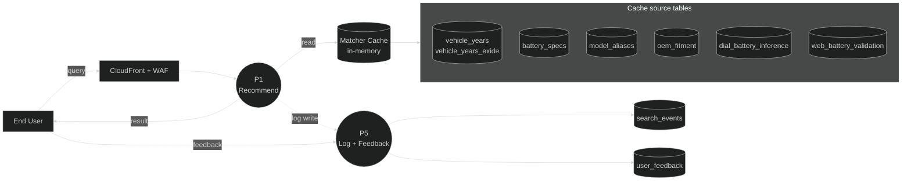

**2. Admin & data pipelines** — how those same source tables get written, and how the cache gets refreshed:

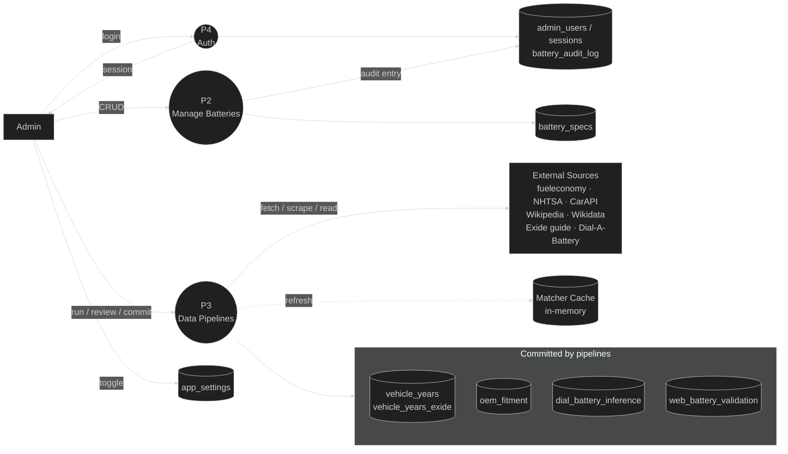

### Level 2 — Process Detail

**3. P1 decomposed — Battery Recommendation.** This shows *data flow only* — which source table each internal step reads, and where a resolved match feeds forward. It deliberately leaves out the branching/scoring logic (thresholds, confidence math, tie-breaks) that decides *which* step actually produces the match — that belongs to a flowchart, not a DFD, and already exists as the [Matching Engine flowchart](#flowchart). The two diagrams complement each other: this one for what data moves where, that one for why:

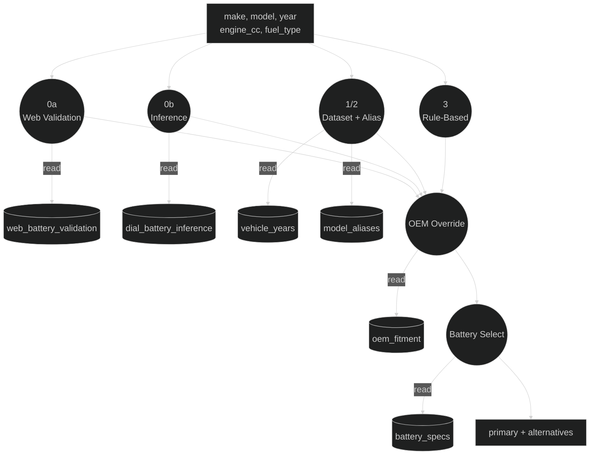

Checked top-to-bottom in that priority order — 0a, then 0b, then 1/2 (+ JDM alias resolution), then 3 — and the first one that resolves a match is the only branch whose result actually feeds into OEM Override; the diagram shows all four converging there because *any* of them can be the one that fires, not because all four run and merge every time.

**4. P3 decomposed — Data Pipelines.** Each of the six pipeline scripts is its own lane. `vehicle_years` and `vehicle_years_exide` are kept as the two physically separate tables they actually are — pipelines 2 and 5 write real rows into one, pipeline 6 writes exploded rows into the other, and neither pipeline touches the other's table directly. A third node, **Exploded Vehicle Coverage**, represents the `UNION ALL` `matcher._vehicles()` builds by joining them at read time — it only ever exists as an in-memory join product, never as its own table, and nothing in this diagram writes to it:

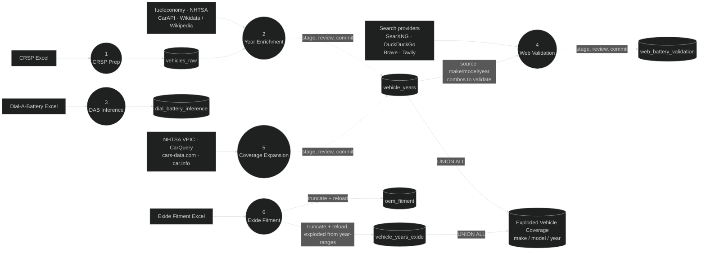

`vehicles_raw`, `web_battery_staging`, and `vehicle_years_staging` (shared by pipelines 2 and 5) are the actual intermediate targets before an admin reviews and commits — collapsed into a single "stage, review, commit" edge here for the same reason staging tables are omitted from the Level-1 diagrams. Pipelines 3 and 6 skip staging entirely (Pipeline 3 writes `dial_battery_inference` directly; Pipeline 6 does a full `TRUNCATE`+reload on every run). Pipeline 6 never writes `vehicle_years` at all — it *explodes* Exide's `[year_from, year_to]` ranges into individual make/model/year existence rows and writes those into `vehicle_years_exide` instead, which is why that edge is labeled "exploded from year-ranges." See [Data Pipelines](#data-pipelines) for why each one does or doesn't go through review.

**Pipeline 4 (Web Validation) reads straight from `vehicle_years` only** — confirmed against `web_battery_validate.py`, which loads its full `(make, model, year)` universe via `SELECT ... FROM vehicle_years` before querying external sources, skipping whatever's already in `web_battery_validation`. It does **not** go through `Exploded Vehicle Coverage` and never touches `vehicle_years_exide` — that join only happens inside `matcher.py`'s in-memory cache (see the Level-1 "Public request path" diagram above), which this pipeline bypasses entirely by querying the database directly.

A few flows worth calling out explicitly, since they're easy to miss:

- **P1 never talks to PostgreSQL directly on the request path** — every `/api/recommend` call is served entirely from the in-memory matcher cache, which is only refilled from the source tables at process startup or when an admin manually triggers a cache refresh. This is *why* the matching engine has no per-request database latency (see [Performance](#performance) → LRU in-memory matcher cache).
- **The log write from P1 to P5 is fire-and-forget** — `app.py` spawns a background thread for `search_events` writes so logging a search never adds latency to the recommendation response the user is waiting on.
- **P3 (pipelines) writes to staging tables first**, not directly to the tables shown in diagram 2's "Committed by pipelines" box — those arrows represent the *final* commit step, which only happens after an admin reviews the staged rows (see [Data Pipelines](#data-pipelines)). The staging tables themselves (`vehicle_years_staging`, `web_battery_staging`, etc.) are omitted from the Level-1 diagrams to keep them at system level, and collapsed into one labeled edge in diagram 4 above — see the [Database Schema](#database-schema) Table Overview for the complete list.
- **`oem_fitment` feeds the cache like every other source table**, but it isn't a matching layer on its own — it's consulted after P1 resolves a vehicle to override the Ah figure (see [OEM Fitment Override](#oem-fitment-override)).

---

## Project Structure

```
├── backend/                     # All backend Python code
│   ├── app.py                   # FastAPI entrypoint — public API, auth, middleware
│   ├── admin_router.py          # All /api/admin/* routes (batteries, audit, sessions, pipelines)
│   ├── admin_auth.py            # bcrypt + HttpOnly cookie session management
│   ├── app_state.py             # In-process maintenance-mode flag
│   ├── matcher.py                # 5-layer battery matching engine
│   ├── models.py                # SQLAlchemy ORM models for all tables
│   ├── db.py                    # SQLAlchemy engine + SessionLocal factory
│   ├── upload_pipeline.py        # Battery spec upload/import handler
│   ├── requirements.txt          # Python dependencies
│   │
│   ├── alembic/                  # Database migration scripts
│   │   ├── env.py
│   │   └── versions/             # One migration file per schema change
│   │
│   ├── pipelines/                 # Data pipeline scripts (see Data Pipelines)
│   ├── scripts/                   # Standalone accuracy/admin/analysis scripts
│   ├── cache/                     # Enrichment cache files (safe to delete)
│   ├── data/                      # Source data files (e.g. Dial-A-Battery Excel)
│   ├── static/                    # Maintenance page + fallback static assets
│   └── uploads/                   # Uploaded battery/CRSP Excel files
│
├── frontend/                   # React + TypeScript frontend
│   ├── src/
│   │   ├── App.tsx             # Root layout — navbar, dark mode, routing, mobile detection
│   │   ├── components/
│   │   │   ├── VehicleFinderForm.tsx   # Desktop search form (Select/Type toggle)
│   │   │   ├── MobileVehicleFinder.tsx # Mobile step-wizard (Make→Model→Year→Details→Result)
│   │   │   ├── AccuracyBar.tsx         # Segmented match accuracy bar
│   │   │   ├── FeedbackModal.tsx       # User feedback submission drawer
│   │   │   ├── Notification.tsx        # Toast notification system
│   │   │   ├── PageLoader.tsx          # Animated battery splash screen
│   │   │   ├── TermsGate.tsx           # Terms & conditions acceptance gate
│   │   │   └── admin/
│   │   │       ├── AdminLayout.tsx     # Admin panel shell (sidebar nav)
│   │   │       └── ProtectedRoute.tsx  # Auth guard for admin routes
│   │   ├── pages/
│   │   │   ├── admin/
│   │   │   │   ├── AdminDashboard.tsx
│   │   │   │   ├── AdminBatteries.tsx
│   │   │   │   ├── AdminFeedback.tsx
│   │   │   │   ├── AdminAuditLog.tsx
│   │   │   │   ├── AdminSessions.tsx
│   │   │   │   ├── AdminTestSessions.tsx
│   │   │   │   ├── AdminVehicleData.tsx    # merged Core Dataset Coverage + OEM Fitment tabs
│   │   │   │   ├── AdminDataPipeline.tsx
│   │   │   │   ├── AdminSearchLog.tsx
│   │   │   │   └── AdminLogin.tsx
│   │   │   └── TestUserLogin.tsx
│   │   ├── lib/
│   │   │   ├── api.ts              # Typed fetch wrappers for public API
│   │   │   ├── adminApi.ts         # Typed fetch wrappers for admin API
│   │   │   ├── testUserApi.ts      # Test-user auth API helpers
│   │   │   ├── brandBranding.ts    # Shared brand logo/color resolution (AdminBatteries + AdminDashboard)
│   │   │   ├── utils.ts            # cn() + useIsMobile() hook
│   │   │   └── TestUserContext.tsx # React context for test-user session state
│   │   └── types/
│   │       └── battery.ts          # TypeScript interfaces for API responses
│   ├── package.json
│   ├── vite.config.ts
│   └── tsconfig.app.json
│
├── docker-compose.yml           # Local Postgres 15 (matches RDS engine version)
├── Jenkinsfile                  # CI/CD pipeline definition
└── .env                         # Environment variables (not committed)
```

Backend `pipelines/` contains: `dataprep.py` (Pipeline 1: CRSP Excel → `vehicles_raw`), `enrich_years.py` (Pipeline 2: production-year enrichment), `dial_battery_clean.py` (Pipeline 3: Dial-A-Battery inference), `web_battery_validate.py` (internet fitment validation, run from the admin UI's Web Validate tab), `vehicle_coverage_expansion.py` (supplementary make/model/year coverage beyond the CRSP catalogue, run from the admin UI's Expansion tab), and `exide_fitment_clean.py` (Pipeline 6: Exide's own global fitment guide, cleaned and filtered to Kenya/UG/TZ-relevant makes). See [Data Pipelines](#data-pipelines) for details.

---

## Getting Started

### Prerequisites

- Python 3.10 or later
- [Bun](https://bun.sh/) (for frontend builds)
- PostgreSQL running and accessible (see [Local Postgres (Docker)](#local-postgres-docker) for a one-command option)
- `.env` file configured (see [Environment Variables](#environment-variables))

### Local Postgres (Docker)

A `docker-compose.yml` at the repo root runs a local Postgres pinned to the same engine version as production RDS (PostgreSQL 15), so migrations and queries that pass locally behave the same way in production. **This is the primary local Postgres for this project.**

```bash
docker compose up -d
```

This starts Postgres on `localhost:5434` (not 5432 — see the comment in `docker-compose.yml`: a native Postgres install commonly already owns 5432 on Windows, and Docker Desktop would otherwise silently bind the container's side on IPv6 instead of erroring, splitting `localhost:5432` across two different databases depending on which address family a client resolves first) with a named volume (`battery_finder_pgdata`) so data survives container restarts. Defaults (`batteryfinder` / `batteryfinder` / `batteryfinderdev`) match the example `.env` below — use it as-is and it works out of the box, or override via `POSTGRES_USER` / `POSTGRES_PASSWORD` / `POSTGRES_DB` / `POSTGRES_PORT` env vars if you point `DATABASE_URL` at different credentials.

```bash
docker compose down       # stop the container, keep data
docker compose down -v    # stop and wipe the volume for a clean slate
```

If you have an existing local Postgres install with real data (e.g. from before this project moved to Docker), migrate it in once:

```bash
# Dump from your existing Postgres (adjust host/port/user/db to match)
pg_dump -h 127.0.0.1 -p 5432 -U <user> -d <db> --no-owner --no-acl --no-comments -F p -f dump.sql

# pg_dump from a newer major version can emit syntax the container's
# Postgres 15 doesn't recognize (e.g. Postgres 18's `\restrict` and
# `transaction_timeout`) — strip those lines before restoring
grep -vF '\restrict' dump.sql | grep -vF '\unrestrict' | grep -vF 'SET transaction_timeout' > dump_clean.sql

# Restore into the (empty) Docker Postgres
cat dump_clean.sql | docker exec -i battery-finder-postgres psql -U batteryfinder -d batteryfinderdev -v ON_ERROR_STOP=1
```

### Set Up Python Virtual Environment

```bash
# Create the virtual environment (first time only)
python -m venv .venv

# Activate it — PowerShell
.venv\Scripts\Activate.ps1

# Activate it — bash / Git Bash
source .venv/Scripts/activate
```

> You must activate the virtual environment in every new terminal session before running `uvicorn`, `python`, or `alembic`.

### Install Dependencies

```bash
# Python (with .venv active) — all backend code lives in backend/
cd backend && pip install -r requirements.txt

# Frontend
cd frontend && bun install
```

### Apply Database Migrations

```bash
cd backend && alembic upgrade head
```

Migration `20260721_c4d5e6f7a8b9` creates the restricted `batteryfinder_public` Postgres role used by public routes and `matcher.py` (see [Environment Variables](#environment-variables)) — set `PUBLIC_DB_PASSWORD` before running it the first time, e.g.:

```bash
cd backend && PUBLIC_DB_PASSWORD=yourpublicrolepassword alembic upgrade head
```

Then add `PUBLIC_DATABASE_URL` to `.env` using that same password (same host/port/db as `DATABASE_URL`, user `batteryfinder_public`).

### Create First Admin User

```bash
cd backend && python scripts/create_admin.py --username admin --password yourpassword
```

Use `--force` to update an existing password:

```bash
python scripts/create_admin.py --username admin --password newpassword --force
```

---

## Running the App

### Production

```bash
# Build the frontend
cd frontend && bun run build && cd ..

# Start the backend (serves built frontend from frontend/dist/)
source .venv/Scripts/activate   # or .venv\Scripts\Activate.ps1 on PowerShell
cd backend && uvicorn app:app --host 0.0.0.0 --port 8000 --proxy-headers --forwarded-allow-ips="*"
```

The app starts on **http://localhost:8000**. Static frontend assets are served directly from `frontend/dist/` by FastAPI.

`--proxy-headers --forwarded-allow-ips="*"` is required in production: the app runs behind an ALB (see Production Architecture below), so without it every request's `request.client.host` is the ALB's own IP rather than the real client's, which silently collapses slowapi's per-client rate limits into one shared bucket for all users. `--forwarded-allow-ips="*"` is safe here because ECS Fargate tasks are only reachable via the ALB — there is no direct public path to the container that could spoof `X-Forwarded-For` from outside.

### Development (hot reload)

```bash
# Terminal 1 — backend (port 8000)
source .venv/Scripts/activate
cd backend && uvicorn app:app --reload

# Terminal 2 — frontend (port 5173, proxies /api to port 8000)
cd frontend && bun run dev
```

Frontend dev server: **http://localhost:5173**

---

## Testing on a Real Device

To test the mobile wizard on your phone during development, expose the Vite dev server via ngrok. Vite's proxy handles `/api` forwarding server-side so only one tunnel is needed.

```bash
# Terminal 1 — backend
cd backend && uvicorn app:app --reload

# Terminal 2 — frontend
cd frontend && bun run dev

# Terminal 3 — tunnel
ngrok http 5173
```

Open the ngrok HTTPS URL on your phone. The mobile wizard activates automatically at screen widths ≤ 600 px.

> **Note:** Geo-restriction (Kenya, Uganda, Tanzania) is enforced at the CloudFront edge in production, not in the app itself — a local `uvicorn` + ngrok setup bypasses CloudFront entirely, so there's no geo-gate to hit here regardless of your ngrok exit node's location.

---

## Mobile Experience

On screens ≤ 600 px wide (phones), the app renders a dedicated **step-by-step wizard** (`MobileVehicleFinder.tsx`) instead of the desktop form. The desktop UI (`VehicleFinderForm.tsx`) is completely unchanged.

### Wizard Flow

```
Step 1: Select Make  →  Step 2: Select Model
→  Step 3: Select Year  →  Step 4: Engine Details (optional)
→  Result screen
```

- **Auto-advance** — selecting a Make immediately fetches models and advances to Step 2. Selecting a Model immediately fetches years and advances to Step 3.
- **Year** requires an explicit "Continue" tap to prevent accidental advances.
- **Engine Details** (fuel type + CC) are optional; a "Skip & Find Battery" button proceeds without them.
- **Result screen** shows: vehicle label, primary battery (Ah, CCA, code with copy button), result accuracy bar, Rate / Shop Now buttons, Dial-a-Battery numbers, collapsible same-tech alternatives, and a "Search Again" reset button.
- Dark mode is fully supported — CSS variables apply automatically.

### Breakpoint

| Width | Experience |
|---|---|
| ≤ 600 px | Mobile wizard (`MobileVehicleFinder`) |
| > 600 px | Desktop form (`VehicleFinderForm`) |

Detection is done client-side via `useIsMobile()` in `frontend/src/lib/utils.ts`, which uses `window.matchMedia` and responds to resize events.

---

## API Reference

All public endpoints are rate-limited and served under `/api/`.

### Request Lifecycle

How a single `POST /api/recommend` call travels from a user's browser or mobile device, through the API middleware chain and matching engine, and back as a response body. Static asset requests (the built SPA) short-circuit at CloudFront to S3 and never reach this path — see [Production Architecture](#production-architecture).

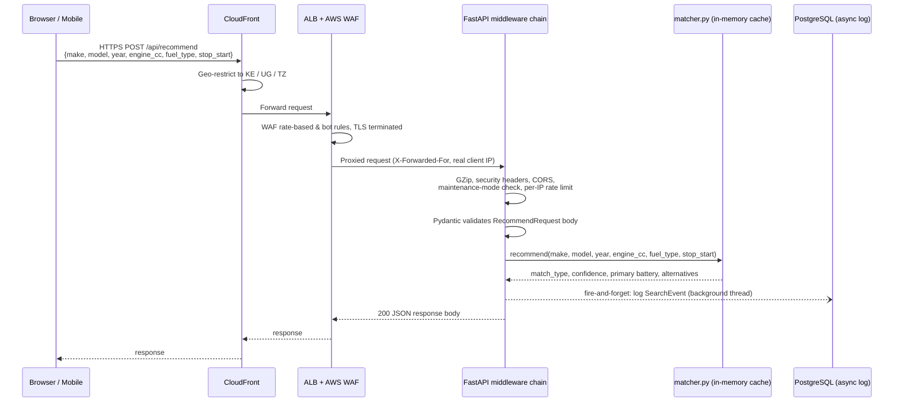

### Public Endpoints

| Method | Endpoint | Rate Limit | Description |
|---|---|---|---|
| `GET` | `/api/makes` | 20/min | List all available vehicle makes |
| `GET` | `/api/models/{make}` | 20/min | List models for a given make |
| `GET` | `/api/years?make=&model=` | 20/min | List available years for a make + model |
| `POST` | `/api/recommend` | 10/min | Get a battery recommendation |
| `POST` | `/api/feedback` | 5/min | Submit feedback on a recommendation |
| `POST` | `/api/battery-search` | 10/min | Search batteries by Ah and/or CCA spec |

`GET /health` (outside `/api/`, 60/min) is a separate unauthenticated liveness/readiness check meant for the ALB target group — the only other health route, `GET /api/admin/health`, is gated behind admin auth, so an ALB pointed at anything under `/api/` would always get 401 and deregister healthy tasks. Returns only `{"status": "ok"/"down"}` after a real `SELECT 1`; the latency/pool-usage diagnostics stay behind the admin-gated route. **Confirm the ALB target group's health-check path is actually pointed at `/health`** (not `/` or something under `/api/admin`) — that's an AWS console/IaC change outside this repo.

### Auth Endpoints (Test Users)

| Method | Endpoint | Rate Limit | Description |
|---|---|---|---|
| `POST` | `/api/auth/register` | 5/min | Register a new test user |
| `POST` | `/api/auth/login` | 10/min | Log in as a test user |
| `POST` | `/api/auth/logout` | — | Log out |
| `GET` | `/api/auth/me` | — | Get current test user info |

### `POST /api/recommend` — Request Body

```json
{
  "make": "TOYOTA",
  "model": "Corolla",
  "year": 2015,
  "engine_cc": 1500,
  "fuel_type": "Petrol",
  "stop_start": true
}
```

`engine_cc` (500–8000), `fuel_type`, and `stop_start` are optional but improve match confidence.

### `POST /api/recommend` — Response

```json
{
  "match_type": "Exact Match",
  "confidence": 100,
  "matched_make": "TOYOTA",
  "matched_model": "COROLLA AXIO G",
  "matched_year": 2015,
  "engine_cc": 1500,
  "fuel_type": "PETROL",
  "battery_region": "NS",
  "recommended_ah": 45,
  "preferred_tech": "MF",
  "ah_source": "oem_fitment",
  "primary": {
    "battery_code": "NS60",
    "model_key": "NS60",
    "ah": 45,
    "cca_en": 390,
    "technology": "MF",
    "origin": "imported"
  },
  "alternatives": []
}
```

---

## Matching Engine

Defined in `matcher.py`. All data sources are loaded from the database at startup via `@lru_cache` and held in memory for fast lookups. Cache can be flushed from the admin dashboard.

### Layer Overview

| Priority | Layer | Data Source | Confidence |
|---|---|---|---|
| 0a | **Web Validation** | `web_battery_validation` — internet-sourced fitment data | 75–90% |
| 0b | **Real-World Inference** | `dial_battery_inference` — Dial-A-Battery historical orders | 80–95% |
| 1 | **Exact Match** | `vehicle_years` — fuzzy model ≥ 90 + exact year | 100% |
| 2 | **Soft Match** | `vehicle_years` — fuzzy model ≥ 60 + year within ±3 | 60–89% |
| 3 | **Rule-Based Fallback** | Engine CC + fuel → Ah bracket table | 40% |

Layers 1/2/3 query `matcher._vehicles()`, which is a `UNION ALL` of `vehicle_years` and `vehicle_years_exide` (make/model/year rows exploded from Exide's fitment guide — see [OEM Fitment Override](#oem-fitment-override) below) — so vehicles that only exist in Exide's global catalog are just as matchable as ones sourced from fueleconomy.gov/NHTSA/etc., without either table needing to know about the other.

Aliases (`model_aliases`) are applied between layers 1/2 and 3 to map international model names (e.g. "Civic") to their JDM dataset equivalents (e.g. "CIVIC FERIO").

The confidence ranges in the table above are ranges only for Layers 1 and 2 — where the fuzzy model score and year distance combine into a continuous number (see [Fuzzy Model Scoring](#fuzzy-model-scoring) §5 below). Layers 0a and 0b each only ever return one of **two fixed values** depending on whether their internal model match was exact or fuzzy (0a: 90 or 75; 0b: 95 or 80) — there's no sliding scale within those layers. The rest of this section walks through every layer and every supporting decision (`recommend()` in `matcher.py`) in the order they actually execute.

### Layer 0a — Web Validation

`_web_validation_lookup(make_n, model_n, year)` checks `web_battery_validation` — data populated offline by [Pipeline 4](#pipeline-4--web-battery-validation) from internet-sourced fitment guides, i.e. what current retailers/manufacturers say a vehicle takes *today*, as opposed to what was actually sold to Kenyan customers historically (that's Layer 0b).

- **This layer is strictly year-exact — there is no ±3-year tolerance here.** `year_rows = make_rows[make_rows["year"] == year]` filters to the exact requested year before any model matching happens; if `web_battery_validation` has data for this make/model but not for the specific year asked, Layer 0a misses entirely and falls through to 0b, even if an adjacent year exists in the table. This is a deliberate asymmetry from Layers 1/2 below — web-sourced fitment data is treated as authoritative only for the exact year it was recorded against.
- Within that exact-year slice, model matching is a single `token_set_ratio` check: an exact `model_n` string match returns confidence **90**; otherwise the best fuzzy candidate (if ≥ 85) returns confidence **75**. No partial_ratio/WRatio cascade and no year-window tie-breaking — see [Fuzzy Model Scoring §6](#fuzzy-model-scoring) for why this is deliberately simpler than the Layer 1/2 algorithm.
- On a hit, the returned `battery_code` is resolved to `(target_ah, technology)` via `_lookup_battery_by_code()` — see [Resolving a Battery Code to Ah and Technology](#resolving-a-battery-code-to-ah-and-technology) below. `resolved_cc`/`resolved_fuel` for the response are then separately best-effort filled in from `vehicle_years` (exact year first, then the same ±3-year window Layers 1/2 use) purely for display — a miss there doesn't affect the confidence or the battery recommendation, since those already came from the web-validated code.
- `matched_make` in the response is the normalized `make_n` (uppercase) for this layer, not the display-cased value from a dataset row — layers 1/2/3 report the original-cased `make`/`model`/`year` from the matched `vehicle_years` row instead, since they resolve through that table directly.

### Layer 0b — Real-World Inference

`_inference_lookup(make_n, model_n)` checks `dial_battery_inference` — the highest-confidence source in the whole engine, because it's not a guess or a spec sheet at all: it's what Dial-A-Battery's call centre actually sold for that make/model historically (see [Pipeline 3](#pipeline-3--dial-a-battery-inference)).

- **This layer has no year dimension at all.** `dial_battery_inference` only records `vehicle_type`, `vehicle_model`, `battery_code`, `frequency`, and `last_sale_date` — no year column — so the lookup matches purely on make + model, regardless of what year the user asked for. A confident recommendation can come back here even for a year `vehicle_years` has no row for whatsoever; the separate attempt to resolve `resolved_cc`/`resolved_fuel`/`matched_year` from `vehicle_years` (same exact-then-±3-year logic as 0a) is purely cosmetic for the response and can legitimately leave `matched_year` as `None` while the recommendation itself stays fully confident.
- Model matching: exact `vmodel_n` string match → confidence **95**; otherwise best `token_set_ratio` fuzzy candidate (if ≥ 85) → confidence **80**.
- When a make/model has multiple historical battery codes on record (different customers, different actual fitments over time), the tie-break is **highest sale frequency first, most recent `last_sale_date` second** — `matched_rows.sort_values(["frequency", "_sort_date"], ascending=[False, False]).iloc[0]`. This means Layer 0b reports whatever was sold *most often*, not necessarily the *most recent* fitment, unless frequencies tie.
- Technology handling is more nuanced here than in any other layer: the parsed technology from the winning battery code is honoured directly when it's `AGM` or `EFB` (treated as a deliberate call-centre upgrade worth preserving) — but when the code parses to `MF`, the engine does **not** trust it blindly for stop-start vehicles, instead recomputing `preferred_tech` via `_preferred_tech()` as if no code-derived hint existed. The reasoning recorded in the code: MF codes in this table often reflect either non-stop-start sales or historically wrong recommendations, so blindly copying `MF` onto a stop-start vehicle being matched today would perpetuate that mistake. Layers 0a and 1/2/3 don't have this special case — it exists only for inference-sourced `MF` codes.

### Known Failure Mode — Dial-A-Battery Inference Blends Every Trim/Year Together

A real example, pulled from a full historical extract of every `MAZDA` row in `dial_battery_inference` (committed at the repo root as `Dial a Battery Failure Points.txt`). `MAZDA DEMIO` alone has 39 distinct historical battery codes on record, spanning 1,290 total sales:

| Battery code | Frequency | Technology |
|---|---|---|
| `045MF NSL POWERLAST` | 599 | Plain MF |
| `NS70MFL POWERLAST` | 408 | Plain MF |
| `Q85MF EFB EXIDE -70 AMPS` | 41 | EFB |
| `N50MFL CHLORIDE EXIDE MAXX` | 41 | Plain MF |
| `DIN55 MF POWERLAST` | 33 | Plain MF |
| `Q85MF L EFB EXIDE -70 AMPS` | 22 | EFB |
| `N50 L MF POWERLAST (SHORT BOX)` | 19 | Plain MF |
| ...31 more codes, 1–16 sales each | | mostly EFB |

Per Layer 0b's tie-break (highest frequency, then most recent sale), `045MF NSL POWERLAST` wins outright — at 599 sales it isn't close. That single code then gets applied to *every* future DEMIO query, at confidence **95** (an exact model-name match), regardless of which DEMIO year or trim the customer actually has.

**Why that's a real failure, not just noise in the data:** the DEMIO nameplate spans well over a decade of trims, and Mazda introduced i-stop (stop-start) on later generations. `_preferred_tech()` elsewhere in this engine treats stop-start as a hard requirement for EFB/AGM — a plain MF battery can't handle the starter-cycling duty a stop-start engine puts on it. Summing every EFB/AGM-technology code in this same DEMIO data (`Q85MF EFB...`, `070 L MF ULTRAPOWER EFB TECHNOLOGY BATTERY`, `065MF (Q85) SEBANG EFB`, and their variants) comes to **146 of the 1,290 total sales — about 11%**, against `045MF NSL POWERLAST` alone at 46%. Those 146 EFB sales aren't noise; they're almost certainly the stop-start-equipped trims within "DEMIO," correctly sold on EFB by the humans handling those calls. But because Layer 0b's tie-break only counts total frequency with no year or stop-start awareness, that 11% is invisible to it — a customer with a newer, stop-start DEMIO gets the 46%-majority plain-MF code recommended at 95% confidence, the same number a same-generation non-stop-start DEMIO customer would get.

**This is a direct, real-world instance of the "no year dimension" limitation already noted above** — worth calling out on its own because the failure here isn't abstract: it's a majority-vote number silently overriding what a same-nameplate stop-start trim actually needs, at high confidence, with no signal anywhere in the response that a real technology split existed underneath that one code.

**Not yet mitigated.** Nothing in `_inference_lookup()` currently detects or corrects for this — its tie-break has no year or stop-start signal at all, unlike `_preferred_tech()` (see [Preferred Technology Selection](#preferred-technology-selection)), which gets this exact case right everywhere else in the engine. A fix would need to weight or filter `dial_battery_inference` candidates by the `stop_start` flag the caller already provides, not just raw sale frequency — not yet implemented.

### Resolving a Battery Code to Ah and Technology

Both Layer 0a's `web_battery_validation.battery_code` and Layer 0b's `dial_battery_inference.battery_code` are free-text strings (whatever the source data recorded), not foreign keys into `battery_specs`. `_lookup_battery_by_code()` resolves either one to a concrete `(target_ah, technology)` pair using the same three-step priority regardless of which layer called it:

1. **Exact match** against `battery_specs.Battery Code` (case/whitespace-normalized).
2. **Fuzzy match** — `token_set_ratio ≥ 85` against every battery code in the catalogue.
3. **Legacy format parser** (`_parse_inference_code()`) — a last resort for codes that don't correspond to any current catalogue entry at all (e.g. a discontinued SKU). It pattern-matches `DIN {ah}...` / `NS{ah}...` prefixes with regex (`DIN\s+0*(\d+)`, `NS\s*0*(\d+)`) and infers technology from whether `AGM`/`EFB` appears in the string, defaulting to `MF` if neither does. Returns `None` (falls through to the layer's own rule-based `_target_ah()`/`_preferred_tech()` calculation) only if none of the three steps produce anything.

### Layers 1 & 2 — Exact & Soft Dataset Match

If neither 0a nor 0b hits, `recommend()` moves to matching directly against `vehicle_years` (unioned with `vehicle_years_exide`). This is the only place `_fuzzy_model_score_for_year()` — documented in full in [Fuzzy Model Scoring](#fuzzy-model-scoring) below — is actually called from `recommend()` itself.

1. The make is resolved first: an exact `make_n` filter via `_make_index()`, falling back to a `WRatio ≥ 75` fuzzy match against every known make if the exact one has no rows (handles typos like "TOYOYA").
2. The model is resolved next: if the normalized input is *already* one of this make's known `model_n` values, that's used directly at score `100` (skipping the fuzzy cascade entirely — this prevents a longer trim variant from ever outscoring a literal exact match). Otherwise `_fuzzy_model_score_for_year()` runs.
3. Once a model is resolved, the *year* determines whether this is a Layer 1 or Layer 2 result: an exact `year` row on that model → **Layer 1**, confidence `100` if the fuzzy score was `≥ 90` else the raw score itself (`"Close Match"`, not `"Exact Match"`, when the model match wasn't clean even though the year was exact). No exact year but a row within `±3` years → **Layer 2**, confidence `max(60, int(model_score) − year_delta × 3)`.
4. Whichever row is picked, that row's own `engine_capacity`/`fuel` become `resolved_cc`/`resolved_fuel` for the response (when present) — the dataset is treated as authoritative over whatever the user typed for those two fields once a match is found.

### JDM Alias Resolution

If Step 2 above resolves a model at all — even via Layer 2's soft year match — alias resolution never runs; it's purely a rescue path for when *no* model in `vehicle_years` scored well enough against the raw input. Kenyan/regional import listings often use international model names (`"Civic"`) that don't appear verbatim in the JDM-sourced dataset (`"CIVIC FERIO"`, `"CIVIC HYBRID"`, ...), so `model_aliases` bridges the two:

1. The typed model is fuzzy-matched (`WRatio ≥ 75`) against this make's known `international_model` values.
2. Every `jdm_model` alias tied to that international model (there can be several, ordered by a `priority` column) is itself fuzzy-matched (`WRatio ≥ 75`) against the make's real `vehicle_years` model names, since alias table entries are free text and don't always exactly match the dataset's normalized keys either.
3. Among all resolved candidates, the same kind of tuple tie-break as `_pick_best` picks the winner: exact year first, then smallest year delta (within ±3), then lowest (best) alias `priority`, then highest JDM fuzzy score.
4. The winning candidate is then run back through the same exact-year/±3-year logic as Step 3 above to produce `matched_year`, `confidence`, and `match_type` — an alias-resolved match can still land as either a `100`/`"Exact Match"` or a `"Close Match"`, exactly like a direct model match would.

### Layer 3 — Rule-Based Fallback

If nothing above resolves a `matched_year` — including a full alias-resolution miss — the engine falls back to pure specification math, using whatever `engine_cc`/`fuel_type` the user supplied (or `1500`cc/`PETROL` if they didn't):

1. `_target_ah(engine_cc, fuel, year)` walks the [Ah Bracket Rules](#ah-bracket-rules) table by engine CC ceiling, picks the column for the normalized fuel type, and — **only in this fallback path** — adds `_year_ah_modifier(year)` on top (`+10` for 2018+, `+5` for 2012–2017, `−5` for pre-2000, `0` otherwise). EVs skip the CC table entirely and use a flat `45`Ah base, since 12V auxiliary battery sizing isn't correlated with traction motor size.
2. This is the **only** path that applies the year modifier at all — Layers 1/2 (and 0a/0b) call `_target_ah()` with `year=None` when they've already resolved a real vehicle, precisely because a dataset-matched vehicle doesn't need an era-based heuristic adjustment on top of its own real data. The code detects "we truly fell through to Layer 3" via `rule_based = confidence == 40` — `40` is `recommend()`'s untouched initial default, so this is really testing "did nothing above ever change it," not a property of the Ah number itself.
3. `confidence` stays at its initial `40`, `match_type` at its initial `"Estimated (Rule-Based)"` — nothing in this branch ever assigns either explicitly, because nothing needed to.

### Preferred Technology Selection

`_preferred_tech(engine_cc, fuel, year, make, stop_start)` decides which battery chemistry to aim for, and runs for **every** layer (0a/0b compute it too, alongside whatever technology hint their matched battery code carried — see Layer 0b above for how those interact). Checked in this exact priority order, first match wins:

| Priority | Condition | Result |
|---|---|---|
| 1 | `fuel == "EV"` | `MF` |
| 2 | `make` is in the luxury/premium set (Audi, BMW, Mercedes, Land Rover, Lexus, Porsche, Volvo, ...) | `AGM` — always, regardless of year, engine size, or stop-start |
| 3 | `fuel == "HYBRID"` | `EFB` |
| 4 | `stop_start` is `True` and (`fuel == "DIESEL"` or `engine_cc ≥ 2500`) | `AGM` |
| 5 | `stop_start` is `True` (and neither of the above) | `EFB` |
| 6 | `stop_start` is `False` | `MF` |

`stop_start` itself is an explicit boolean the frontend sends per-request (its own selector in `VehicleFinderForm.tsx`) — `matcher._infer_stop_start()` (make/year heuristics) exists in the module but is dead code, kept only in case that explicit input is ever made optional again.

### Battery Region — NS/JIS vs DIN

`_make_region(make)` maps the vehicle's make to a battery form factor/terminal standard: Japanese, Korean, and Chinese makes (Toyota, Honda, Nissan, Hyundai, Kia, Chery, ...) get `"NS"` (JIS), everything else — European, American, Indian, or unrecognized — defaults to `"DIN"`. This is a fixed allow-list (`_NS_MAKES`), not inferred from any other signal. `_select_batteries()` then filters `battery_specs` down to only that region before doing anything else, using `_battery_region()` on each row's `Model Key` (a `Model Key` starting with `"DIN"` is DIN, everything else is treated as NS) — so a battery physically incompatible with the vehicle's region can never be returned, even as an alternative.

### Primary Battery & Alternatives Selection

`_select_batteries(target_ah, preferred_tech, region)` is the single function every layer above converges on — regardless of whether `target_ah` came from a battery code (0a/0b), an OEM fitment override, or the CC/fuel bracket table (1/2/3), the selection logic downstream is identical:

1. Filter the catalogue to the given `region` (see above).
2. Take every battery whose `Ah` **exactly** equals `target_ah` — there's no tolerance window here, unlike the ±15% search used by `search_by_specs()` for the manual AH/CCA admin lookup. Sort those by technology priority (`EFB` > `AGM` > `MF` > `SB (Flooded)`) and, within the same technology, imported origin before local.
3. Pick the first row whose technology equals `preferred_tech`. If none of the exact-Ah rows match that technology, fall back to the best-priority technology available at that same exact Ah instead (never silently switch Ah just to hit the preferred chemistry).
4. If literally nothing is stocked at `target_ah` in this region — no technology at all — fall back to the single nearest-Ah row in the whole (region-filtered) catalogue, `idxmin()` on absolute Ah distance, with no technology preference applied at that point.
5. **Alternatives** are computed from whatever the primary actually ended up being (`primary_ah_val`, `primary_tech`), not from the original `target_ah`/`preferred_tech` inputs — same Ah, same CCA, same technology as the primary, different battery code (i.e. a different brand/variant of what is otherwise the identical spec), imported-first, capped at 6.

This is why the response always includes a primary recommendation even when the exact requested Ah/technology combination isn't stocked — the degradation path (technology substitution, then Ah substitution) is deterministic and always produces *something*, rather than the endpoint ever returning "no battery found."

### OEM Fitment Override

`oem_fitment` (Exide's own official global fitment guide — see [Pipeline 6](#pipeline-6--exide-fitment-guide)) is **not** a sixth matching layer and never affects which layer resolves the vehicle or its confidence score. Instead, once *any* of the layers above has resolved a `(make, model, year)`, `matcher._fitment_override()` checks `oem_fitment` for a row covering that same vehicle (exact or fuzzy model match, year within the row's `[year_from, year_to]` range). If found, its **Ah replaces** whatever that layer would otherwise have used — including overriding a Layer 0a/0b confirmed-battery-code Ah — since Exide's own spec sheet is treated as the most trustworthy source whenever it's available. The response's `ah_source` field records which path actually supplied the number: `"oem_fitment"`, `"battery_code"` (0a/0b's normal path), or `"cc_bracket_estimate"` (1/2/3's normal path).

**Technology preference is deliberately NOT taken from `oem_fitment`.** Many of its technology values are Exide product-tier names (`PREMIUM`, `CLASSIC`, `START PRO`, ...) rather than actual battery chemistry, and even where it is a real chemistry value, this app's own luxury-make/stop-start rules must keep deciding `preferred_tech` — luxury makes always prefer AGM (falling back to whatever `_select_batteries()` finds best-stocked at that Ah if no AGM exists, normally EFB), and stop-start vehicles prefer EFB/AGM per `_preferred_tech()` — rather than deferring to Exide's per-vehicle tech column, which doesn't know about local stock or this app's brand-tier policy. `preferred_tech` is computed *before* `_fitment_override()` runs and is passed into it — used only to pick between tiers (below), never overwritten by it.

**Picking among multiple tiers for the same vehicle.** A single make/model/year-range in `oem_fitment` commonly has several rows — Exide lists multiple battery tiers for the same trim, e.g. a base `50Ah/MF` option alongside `55Ah/EFB` and `60Ah/EFB` upgrades. This is legitimate data, not duplicates (see `OemFitment`'s unique constraint in [Database Schema](#database-schema)). When more than one tier matches the resolved model/year, `_fitment_override()` prefers whichever tier's `technology` matches the `preferred_tech` already decided above, and only falls back to the highest Ah across *all* tiers when none match. This keeps the Ah figure paired with a technology Exide actually offered together — e.g. for that Abarth Grande Punto, a non-stop-start match resolves to `50Ah`/`MF` while a stop-start match resolves to `60Ah`/`EFB`, rather than always taking the highest listed Ah (`60`) regardless of which technology this app is actually about to sell.

**Alternatives still come from the main catalogue either way.** The override only changes the `target_ah` *input* to `_select_batteries()` (`preferred_tech` is untouched by the override — see above) — every code path (all three `_select_batteries()` call sites in `matcher.py`) calls that same function afterward, which always queries `battery_specs` for the primary battery and up to 6 alternatives (same Ah, same CCA, same technology as primary). Falling into the OEM fitment route doesn't swap in a different alternatives source or skip alternatives — it just makes the Ah target that `_select_batteries()` searches around more precise.

### Flowchart

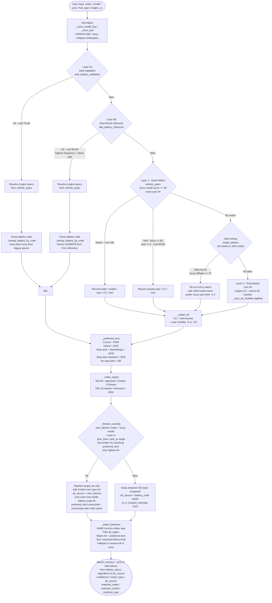

### Fuzzy Model Scoring

The same base model (e.g. "COROLLA") can exist in the dataset as dozens of distinct trims ("COROLLA AXIO G", "COROLLA FIELDER X", ...), and users rarely type the full trim name. `_fuzzy_model_score_for_year()` (in `matcher.py`) decides which stored trim a typed model name actually refers to, and is what Layers 1 and 2 call to resolve the model. This section documents its full algorithm — normalization, the three-scorer cascade, candidate tie-breaking, the un-windowed fallback, and exactly how the resulting score becomes the confidence percentage shown to the user.

#### 0. Normalization first

Both the typed input and every stored model name are run through `_norm_model_key()` before any comparison happens, so spacing/punctuation differences never cost match quality:

1. Uppercase + strip surrounding whitespace.
2. Hyphens become spaces (`"CX-5"` → `"CX 5"`).
3. A space is inserted at every letter↔digit boundary in both directions (`"CX5"` → `"CX 5"`, `"5CX"` → `"5 CX"`).
4. Repeated whitespace collapses to a single space.

So `"CX5"`, `"CX-5"`, and `"CX 5"` all normalize to the identical key `"CX 5"` and are therefore treated as exactly the same string by every scorer below — none of the fuzziness described in this section is needed just to bridge that gap; it's handled deterministically before scoring starts.

#### 1. Three-scorer cascade

`_fuzzy_model_score_for_year()` tries three RapidFuzz scoring methods against the make's known model names, in order from most to least strict, and stops at the first one that produces at least one candidate clearing its threshold:

| Order | Scorer | Threshold | What it catches |
|---|---|---|---|
| 1 | `partial_ratio` | ≥ 80, only for queries **4+ characters** | The typed text appears as a prefix/substring of the candidate — lets `"COROLLA"` match `"COROLLA AXIO G"`. Short queries are excluded here because a 2–3 letter substring would match almost anything (e.g. `"C"` inside `"C CLASS"`), so they skip straight to `token_set_ratio`. |
| 2 | `token_set_ratio` | ≥ 72 | Compares the *set* of words in each name, ignoring order and duplicates. Still scores well when query and candidate share some words but not all — e.g. `"MARCH ACTIVE"` vs `"MARCH G"` share the token `"MARCH"` even though the trim word differs, which a plain edit-distance ratio would score much lower. |
| 3 | `WRatio` | ≥ 60 | RapidFuzz's general-purpose blended score, combining several comparison strategies internally. Loosest and least targeted of the three — used only when neither `partial_ratio` nor `token_set_ratio` found anything, as a last-resort catch-all. |

Each stage calls `process.extract(query, model_choices, scorer=..., limit=N)` (limits of 60/80/60 respectively) to pull the top N raw candidates for that scorer, filters out anything below its threshold, and hands the survivors to the tie-breaking step below (§2). Only if that step finds nothing usable among a stage's survivors does the cascade move on to the next scorer — a stage "producing candidates" and a stage "producing a usable *pick*" are different conditions, because §2 can still reject every one of a stage's candidates for having no row anywhere near the requested year.

#### 2. Picking among candidates that clear the threshold (`_pick_best`)

The single highest fuzzy score is deliberately **not** the deciding factor once a stage has candidates — several real trims routinely land within a point or two of each other on text similarity alone, and the top scorer isn't always the trim actually sold in the year the user asked about (a short base name like `"FIT"` fuzzy-matches dozens of `"FIT ..."` trims at or near 100). Instead, every surviving candidate is scored into a tuple and the tuples are compared lexicographically (Python tuple comparison — leftmost element wins first, later elements only break ties):

```text
(starts_with, is_exact_year, -year_delta, score, model_n)
```

1. **`starts_with`** (1 or 0) — does the candidate genuinely start with what the user typed? Checked by `_starts_with_query()`: true if the candidate (hyphens normalized to spaces) starts with the *full* query, **or** starts with just the query's *first word* (also checked with hyphens normalized). This lets a partial query like `"MARCH"` still count as a prefix match against `"MARCH G"` without requiring the whole query to literally prefix the candidate.
2. **`is_exact_year`** (1 or 0) — does this candidate have a row for the *exact* year requested? Looked up via `years_by_model` (see §3) — an O(1) dict/tuple lookup, not a fresh dataframe scan.
3. **`-year_delta`** — if not an exact-year hit, is there at least one row within **±3 years**? Candidates with nothing in that window are dropped entirely (`continue`, not scored) — this field is the negated distance to the closest in-window year, so *smaller* deltas naturally sort *higher* once negated.
4. **`score`** — the raw fuzzy score from whichever scorer stage produced this candidate. Only reached as a tiebreaker once the three fields above are equal.
5. **`model_n`** — final deterministic tiebreaker (alphabetical) if everything else ties exactly.

In plain terms: a candidate that's a genuine prefix match *and* has the exact year on record always wins over one that merely scores a few points higher on text similarity. This is why the matcher reliably lands on the correct year's trim instead of a different-year trim that happened to score marginally higher.

#### 3. Where the candidate list and year data come from

`model_choices` — the list of model names actually scored against — comes from `years_by_model.keys()`, a `{model_n: sorted_years_tuple}` dict precomputed once per make by `matcher._make_index()` (see [Performance](#performance) → LRU in-memory matcher cache). The same dict supplies `_cand_years()`'s O(1) lookups in §2 above. Without this cache, both the candidate list and every one of `_pick_best`'s per-candidate year checks would require re-filtering the full in-memory `vehicle_years` dataframe with a pandas boolean mask — once for the make, and again for every one of the ~60–80 candidates a single scorer stage can return. If `years_by_model` isn't supplied (some callers omit it), the function falls back to deriving `model_choices` from `make_df["model_n"].unique()` and re-filtering `make_df` per candidate directly — functionally identical, just slower.

#### 4. Fallback when nothing exists near the requested year

If all three scorer stages run and every one of their candidates gets dropped in §2 for having no row within ±3 years of the requested year (`_pick_best` returns `None` each time), the function falls through to:

```python
return _fuzzy_model_score(q, model_choices)
```

`_fuzzy_model_score()` is the same three-scorer cascade with the exact same per-stage thresholds, but with **no year awareness at all** — it just returns whichever candidate scores highest, regardless of what years that model has on record. This exists purely to preserve a sane return value for callers that don't care about year proximity; inside `recommend()` itself, a model resolved this way almost always ends up unused for the model match, because immediately after resolution `recommend()` independently re-checks that same model's rows for an exact-year hit and then a ±3-year window — and since the model was only reachable via this branch *because* nothing existed in that window, both checks come back empty, `matched_year` stays `None`, and the vehicle falls through to the JDM-alias lookup and ultimately Layer 3's engine-CC rule-based fallback. In other words: recognizing a model name by text alone is not sufficient to produce a dataset match — a usable year is always required too, and this fallback exists to fail that requirement cleanly rather than to quietly succeed with the wrong year.

#### 5. From fuzzy score to confidence

Once `_fuzzy_model_score_for_year()` returns `(matched_model_n, model_score)`, `recommend()` turns that pair — plus how close the matched year is — directly into the user-facing `confidence` and `match_type`:

| Case | `confidence` | `match_type` |
|---|---|---|
| Exact year row exists **and** `model_score ≥ 90` | `100` | `"Exact Match"` |
| Exact year row exists but `model_score < 90` | `int(model_score)` | `"Close Match"` |
| No exact year, but a row exists within ±3 years | `max(60, int(model_score) − year_delta × 3)` | `"Close Match"` |

So a model resolved at score 85 with an exact year match reports 85% confidence as a "Close Match" (not 100%, since 85 < 90) — but the *same* score 85 with the nearest row 2 years off reports `max(60, 85 − 2×3) = 73%`. The `× 3`-per-year penalty and the `60` floor together mean year distance dominates the final number once you're outside an exact hit, while the underlying text-similarity score still sets the ceiling.

#### 6. This is separate from the simpler fuzzy checks in Layers 0a/0b

Layers 0a (`_web_validation_lookup()`) and 0b (Dial-A-Battery inference) do their own, much simpler fuzzy model resolution against their own tables (`web_battery_validation`, `dial_battery_inference`) — a single `process.extractOne(..., scorer=fuzz.token_set_ratio)` call at a flat `≥ 85` threshold, with no partial_ratio/WRatio cascade, no year-window candidate filtering, and no `_pick_best` tie-breaking. `_fitment_override()`'s own model resolution against `oem_fitment` is similar but pools *every* model tied at the best `token_set_ratio` score (not just RapidFuzz's arbitrary first pick among ties) before choosing among them by technology match. None of these three call `_fuzzy_model_score_for_year()` — they're independent, deliberately simpler implementations against smaller, higher-trust tables, described in their own docstrings and in [OEM Fitment Override](#oem-fitment-override) above.

### Ah Bracket Rules

| Engine CC | Petrol (Ah) | Diesel (Ah) | Hybrid (Ah) |
|---|---|---|---|
| ≤ 1000 | 35 | 40 | 35 |
| ≤ 1600 | 45 | 50 | 45 |
| ≤ 2000 | 55 | 65 | 55 |
| ≤ 2500 | 70 | 80 | 65 |
| ≤ 3000 | 80 | 90 | 80 |
| ≤ 4000 | 90 | 100 | 90 |
| > 4000 | 100 | 120 | 100 |

Year modifier applied on top: `< 2000 → −5` · `2000–2011 → 0` · `2012–2017 → +5` · `≥ 2018 → +10`.

### Result Accuracy Bar

The result card renders a segmented accuracy bar (`AccuracyBar.tsx`) with four independently scored factors:

| Segment | Max | Color | Scoring |
|---|---|---|---|
| Car Found | 50 pts | Green | 50 for exact/real-world; 20–40 for close; 0 for fallback |
| Year | 25 pts | Blue | 25 exact; decreasing with delta; 0 if > 3 years off |
| Data Quality | 15 pts | Violet | 15 real-world source; 12 model found; 4 fallback |
| Engine Info | 10 pts | Amber | 10 model matched; 6 CC provided; 2 otherwise |

Total (0–100) shown as a percentage with a 0.7 s ease-out fill animation.

---

## Admin Dashboard

Protected under `/api/admin/*`. Access requires an HttpOnly session cookie issued by `POST /api/admin/login`.

### Pages

| Page | Route | Description |
|---|---|---|
| Dashboard | `/admin` | Live stats, match breakdown card, health indicator. Cards animate in with staggered slide-in on load. Auto-refreshes every 15 minutes. **Makes & Models** card shows Core Dataset / OEM Fitment entry counts side by side with a combined total, plus core/fitment pairs in the footer. **Battery Records** card shows the active total, a Local/Imported origin split, an MF/EFB/AGM/Flooded technology-mix line, and small logo thumbnails for featured brands (Powerlast, Sebang, Chloride Exide AGM). |
| Battery Specs | `/admin/batteries` | Brand tile overview (with orbital loader), brand detail table, full search/filter/paginate table. CRUD and bulk Excel upload available in manage mode. |
| Search Log | `/admin/search-log` | Paginated table of every `/api/recommend` call: vehicle, input, battery returned, match type, confidence, IP. Download PDF exports a full branded A4 report (jsPDF, lazy-loaded). |
| Feedback | `/admin/feedback` | All user-submitted feedback with rating, accuracy, match metadata. Rows animate in staggered on load. |
| Audit Log | `/admin/audit` | Immutable history of every battery spec create/update/delete. |
| Sessions | `/admin/sessions` | Active admin sessions with revoke. |
| Data Pipeline | `/admin/data-pipeline` | Three tabs: **CRSP Pipeline** (run `dataprep.py`, stream stage progress, review output summary, then Staging Review to commit to `vehicle_years`), **Web Validate** (run `web_battery_validate.py` — toggle providers, choose phase, monitor live progress with pause/resume/cancel, fix suspicious Ah values, resolve conflicts, commit to master), **Expansion** (run `vehicle_coverage_expansion.py` to widen make/model/year coverage beyond the CRSP catalogue). Exide fitment ingestion (`exide_fitment_clean.py`) is CLI-only and has no tab here — see [Pipeline 6](#pipeline-6--exide-fitment-guide). |
| Vehicle Data | `/admin/vehicle-data` | Two tabs, replacing the old separate Coverage page: **Core Dataset Coverage** (web-validation match %, coverage-by-make, paginated matched/unmatched vehicle tables — the full former Coverage page content, unchanged) and **OEM Fitment** (searchable paginated browse of `oem_fitment`: make, model, year range, Ah, technology, dimensions, cylinder CC). |

### API Endpoints

| Method | Endpoint | Description |
|---|---|---|
| `POST` | `/api/admin/login` | Admin login (5/min) |
| `POST` | `/api/admin/logout` | Clear session |
| `GET` | `/api/admin/me` | Current admin user |
| `GET` | `/api/admin/stats` | Usage stats, table counts (including `oem_fitment`/`vehicle_years_exide` totals and pairs, and battery origin/technology breakdown), today's match breakdown (3 queries) |
| `GET` | `/api/admin/health` | Database connectivity + latency check, cluster-wide connection count (`pg_stat_activity`, ground truth across all ECS tasks) alongside this task's own pool usage |
| `GET/POST` | `/api/admin/batteries` | List (paginated) or create battery specs |
| `PATCH` | `/api/admin/batteries/{id}` | Update a battery spec |
| `DELETE` | `/api/admin/batteries/{id}` | Soft-delete a battery spec |
| `POST` | `/api/admin/batteries/upload` | Bulk upload from Excel |
| `GET` | `/api/admin/batteries/export` | Export battery specs as Excel |
| `GET` | `/api/admin/audit` | Full change history (paginated, filterable) |
| `GET` | `/api/admin/search-events` | Paginated search event log |
| `POST` | `/api/admin/cache/refresh` | Reload matcher caches from DB, including `_fitment()` (OEM fitment override data) |
| `GET/DELETE` | `/api/admin/sessions` | View or revoke admin sessions |
| `GET` | `/api/admin/vehicle-data/core` | Paginated, searchable browse of `vehicle_years` (Vehicle Data → Core Dataset Coverage tab underpinnings) |
| `GET` | `/api/admin/vehicle-data/oem-fitment` | Paginated, searchable browse of `oem_fitment` (Vehicle Data → OEM Fitment tab) |

### Search Event Logging

Every call to `POST /api/recommend` is logged asynchronously to `search_events` via a fire-and-forget background thread. No latency is added to the recommendation response.

Fields captured per event:

| Field | Source |
|---|---|
| `make`, `model`, `year` | Request body |
| `engine_cc`, `fuel_type` | Request body |
| `battery_returned`, `battery_ah` | `result["primary"]["battery_code"]` and `ah` |
| `match_type`, `confidence`, `matched` | Matcher result |
| `ip_address` | `X-Forwarded-For` header (proxy-safe, comma-split, 45-char clamp) |
| `timestamp` | UTC at time of request |

---

## Data Pipelines

Run scripts in order when refreshing the dataset. All pipeline scripts live in `backend/pipelines/` and are run with `backend/` as the working directory.

### Pipeline 1 — CRSP Data Prep

```bash
cd backend && python pipelines/dataprep.py
```

Input: `New-CRSP---July-2025.xlsx` (not committed)
Output: `battery_lookup_dataset.csv`

### Pipeline 2 — Year Enrichment

```bash
cd backend && python pipelines/enrich_years.py
```

Fetches production years from (in order): fueleconomy.gov bulk CSV → NHTSA VPIC → CarAPI → Wikidata/Wikipedia.
Results cached in `backend/cache/year_cache.json` and `backend/cache/fueleconomy_vehicles.csv`. Safe to delete to force a full re-fetch.

### Pipeline 3 — Dial-A-Battery Inference

```bash
cd backend && python pipelines/dial_battery_clean.py
```

Input: `backend/data/Dial-A-Battery Data - 2023-2026.xlsx`
Output: `dial_battery_inference` table

### Pipeline 4 — Web Battery Validation

Normally run from the admin UI (`/admin/data-pipeline` → Web Validate tab), which adds pause/resume/cancel controls and a staging review step. Can also run standalone:

```bash
cd backend && python pipelines/web_battery_validate.py
```

Queries external sources (SearXNG → DuckDuckGo → Brave → Tavily, in order) for the internet-accepted battery on each `(make, model, year)` combination not already in `web_battery_validation`. See [Environment Variables](#environment-variables) for the optional provider keys (`SEARXNG_URL`, `BRAVE_SEARCH_API_KEY`, `TAVILY_API_KEY`) — any source without a key/URL configured is simply skipped.
Output: `web_battery_validation` table (via `web_battery_staging` review)

### Pipeline 5 — Vehicle Coverage Expansion

Supplementary pipeline that widens `vehicle_years` beyond the CRSP catalogue for Kenya-relevant makes underserved by fueleconomy.gov, using NHTSA VPIC, CarQuery, and two scrapers (cars-data.com, car.info). Normally run from the admin UI (`/admin/data-pipeline` → Expansion tab); can also run standalone:

```bash
cd backend && python pipelines/vehicle_coverage_expansion.py [--makes toyota,nissan,...] [--years 1990-2026]
```

`engine_capacity` and `fuel` are left `NULL` for these rows — the matcher's exact/soft-match layers only need make/model/year.
Output: `vehicle_years_staging` (same staging → commit workflow as the CRSP pipeline)

### Pipeline 6 — Exide Fitment Guide

CLI-only, no admin UI trigger (mirrors Pipeline 3's precedent) — run whenever Exide sends an updated global fitment catalog:

```bash
cd backend && python pipelines/exide_fitment_clean.py
```

Input: `EXIDE BATTERY FINDER - <date>.xlsx` at the repo root (two sheets: `PASSENGER CARS`, `COMMERCIAL VEHICLES`) — **not committed to git**; place a copy at the repo root before running.

Cleans a genuinely messy global source file: fixes a ~40% Ah/Type column swap on the passenger sheet (detected per-row — whichever cell is numeric is Ah), parses inconsistent year-range strings (`"2016- PRESENT"`, `"1989-2007"`, etc.) with sanity bounds to reject data-entry garbage, strips redundant make-prefixes and trailing chassis-code suffixes from model names, canonicalizes make spelling (aliases regional divisions like `FORD USA`/`FORD AUSTRALIA` into `FORD`, `KG MOBILITY` into `SSANGYONG`, etc.), and — the biggest cut — **filters out makes with no realistic Kenya/Uganda/Tanzania presence** (farm equipment, foreign buses/coaches, foreign heavy-haulage trucks, defunct/vintage brands, hypercars, microcars, and obscure Chinese/EV brands with no local import channel), taking the global catalog from 365 distinct makes down to a curated ~76.

Writes two tables, both fully `TRUNCATE`+reloaded on every run (idempotent, matches Pipeline 3's pattern) — **`vehicle_years` itself is never written to**:

- `oem_fitment` — Ah/technology fitment specs, kept as year-ranges (not exploded). Read by `matcher._fitment_override()` (see [OEM Fitment Override](#oem-fitment-override)).
- `vehicle_years_exide` — make/model/year existence rows, exploded from those ranges so they're searchable. Unioned into `matcher._vehicles()` alongside `vehicle_years`, never merged into it directly — see [Layer Overview](#layer-overview).

After running, restart the app or hit `POST /api/admin/cache/refresh` to pick up the new data — there's no automatic reload.

---

## Database Schema

Managed by Alembic (`backend/alembic/versions/`). Apply all migrations with `alembic upgrade head` from `backend/`.

### Table Overview

| Table | Written by | Read by | Description |
|---|---|---|---|
| `vehicles_raw` | `dataprep.py` | pipelines | Cleaned CRSP vehicle records |
| `vehicle_years` | `enrich_years.py` | `matcher.py` | Per-make/model/year rows with CC + fuel |
| `vehicle_years_staging` | `enrich_years.py` / `vehicle_coverage_expansion.py` | admin UI | Enriched rows pending admin review |
| `vehicle_years_versions` | admin UI | admin UI | One record per approved merge commit |
| `vehicle_years_changelog` | admin UI | admin UI | Row-level diffs for rollback |
| `vehicle_years_unmatched` | `enrich_years.py` | admin UI | Models that failed year enrichment |
| `vehicle_years_exide` | `exide_fitment_clean.py` | `matcher.py` (unioned with `vehicle_years`) | Make/model/year existence rows exploded from Exide's fitment guide — `vehicle_years` itself is never written to |
| `oem_fitment` | `exide_fitment_clean.py` | `matcher.py` | Exide's Ah/technology fitment specs, kept as year-ranges — see [OEM Fitment Override](#oem-fitment-override) |
| `battery_specs` | admin upload | `matcher.py` | Battery catalogue (soft-delete via `deleted_at`) |
| `battery_audit_log` | `admin_router.py` | admin UI | Immutable change history |
| `model_aliases` | one-time import | `matcher.py` | International → JDM model name mappings |
| `dial_battery_inference` | `dial_battery_clean.py` | `matcher.py` | Real-world call-centre order data |
| `web_battery_validation` | `web_battery_validate.py` | `matcher.py` | Internet-validated fitment data |
| `web_battery_staging` | `web_battery_validate.py` | admin UI | Web validation rows pending review |
| `web_battery_validation_versions` | admin UI | admin UI | One record per approved web validation commit |
| `web_battery_validation_changelog` | admin UI | admin UI | Row-level diffs |
| `enrichment_cache_meta` | pipelines | admin UI | Cache download timestamps for external sources |
| `pipeline_run_log` | `web_battery_validate.py` | admin UI | Web validation run history |
| `fueleconomy_vehicles` | `enrich_years.py` | pipelines | fueleconomy.gov vehicle cache |
| `api_usage_quota` | pipelines | admin UI | Per-provider API call quotas (30-day rolling) |
| `admin_users` | `create_admin.py` | `admin_auth.py` | Admin credentials (bcrypt, cost 12) |
| `admin_sessions` | `admin_auth.py` | `admin_auth.py` | Active admin sessions (8-hour TTL) |
| `search_events` | `app.py` (`/api/recommend`) | admin UI | Append-only log of every battery recommendation request |
| `admin_stats` | `app.py` middleware | admin UI | Persisted usage counters |
| `app_settings` | admin UI | app | Key-value runtime configuration |
| `test_users` | `/api/auth/register` | `app.py` | Test user accounts |
| `test_user_sessions` | `/api/auth/login` | `app.py` | Test user tokens (24-hour TTL) |
| `user_feedback` | `/api/feedback` | admin UI | User feedback on recommendations |

### Core App Tables

Solid lines (`--`) are enforced foreign keys. Dashed lines (`..`) are logical references by value (no DB-level FK).

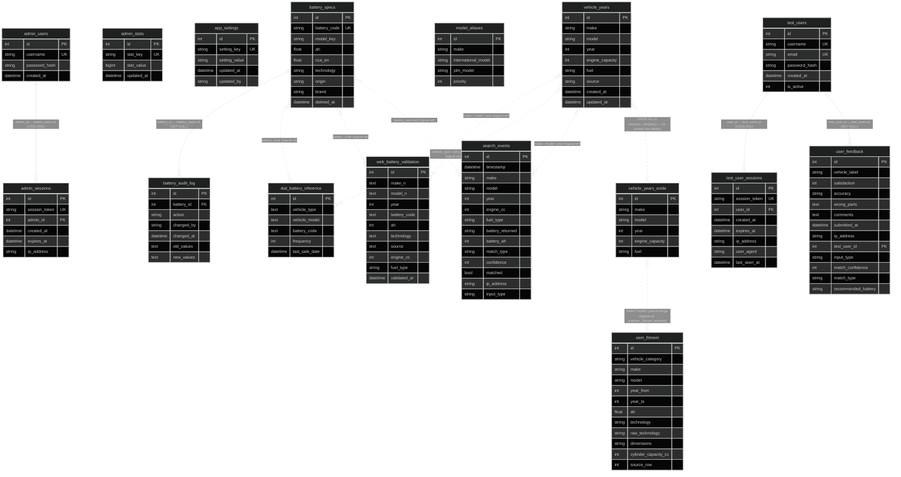

### Pipeline & Staging Tables

Solid lines (`--`) are enforced foreign keys. Dashed lines (`..`) show pipeline data flow (no DB-level FK).

```mermaid
%%{init: {'theme': 'dark', 'themeVariables': {'fontSize': '18px'}}}%%
erDiagram
    vehicles_raw {
        int id PK
        string make
        string model
        string model_number
        int engine_capacity
        string fuel
    }
    vehicle_years {
        int id PK
        string make
        string model
        int year
        int engine_capacity
        string fuel
        string source
    }
    vehicle_years_staging {
        int id PK
        text run_id
        string make
        string model
        int year
        int engine_capacity
        string fuel
        string source
        bool is_valid
        bool conflict
        text conflict_detail
        datetime staged_at
    }
    vehicle_years_versions {
        text id PK
        int version_number
        datetime committed_at
        text run_id
        int committed_count
        int updated_count
        int removed_count
        string committed_by
        string initiated_by
    }
    vehicle_years_changelog {
        int id PK
        text version_id FK
        string make
        string model
        int year
        text change_type
        text old_values
        text new_values
    }
    vehicle_years_unmatched {
        int id PK
        text run_id
        string make
        string model
        string fuel
        datetime recorded_at
    }
    web_battery_validation {
        int id PK
        text make_n
        text model_n
        int year
        text battery_code
        text run_id
        text version_id
    }
    web_battery_staging {
        int id PK
        text run_id
        text make_n
        text model_n
        int year
        text battery_code
        int ah
        text technology
        bool is_valid
        bool conflict
        datetime staged_at
    }
    web_battery_validation_versions {
        text id PK
        int version_number
        datetime committed_at
        text run_id
        int committed_count
        int removed_count
        text committed_by
        text initiated_by
    }
    web_battery_validation_changelog {
        int id PK
        text version_id FK
        text make_n
        text model_n
        int year
        text change_type
        text old_values
        text new_values
    }
    enrichment_cache_meta {
        text key PK
        datetime downloaded_at
        bigint file_size_bytes
        int record_count
        datetime updated_at
    }
    pipeline_run_log {
        int id PK
        text run_id
        text status
        datetime finished_at
        int combos_processed
        int combos_matched
    }
    fueleconomy_vehicles {
        int id PK
        int year
        string make
        string model
    }
    api_usage_quota {
        int id PK
        string provider
        string month
        int calls_made
        int quota_limit
        datetime period_start
        datetime period_end
    }

    vehicle_years_versions          ||--o{ vehicle_years_changelog          : "version_id → vehicle_years_versions.id (CASCADE)"
    web_battery_validation_versions ||--o{ web_battery_validation_changelog : "version_id → web_battery_validation_versions.id (CASCADE)"
    vehicles_raw                    }o..o{ vehicle_years                    : "dataprep.py produces"
    fueleconomy_vehicles            }o..o{ vehicle_years                    : "enrich_years.py populates from"
    vehicle_years_staging           }o..|| vehicle_years                    : "admin commit merges into"
    web_battery_staging             }o..|| web_battery_validation           : "admin commit merges into"
    web_battery_validation_versions |o..o{ web_battery_validation          : "version_id (run tracking)"
```

### Indexes

All indexes are created and dropped via Alembic migrations — never applied by hand.

#### `battery_specs`

| Index | Columns | Type | Purpose |
| --- | --- | --- | --- |
| `battery_specs_pkey` | `id` | Primary key | Row lookup |
| `battery_specs_battery_code_key` | `battery_code` | Unique | Upsert deduplication |
| `ix_battery_specs_model_key` | `model_key` | B-tree | Matcher model-key lookups |
| `ix_battery_specs_ah` | `ah` | B-tree | Ah-bracket queries |
| `ix_battery_specs_active` | `id WHERE deleted_at IS NULL` | Partial B-tree | Covers all admin list queries and matcher loader; only indexes active (non-deleted) rows |

#### `vehicle_years`

| Index | Columns | Type | Purpose |
| --- | --- | --- | --- |
| `vehicle_years_pkey` | `id` | Primary key | Row lookup |
| `uq_vehicle_years` | `(make, model, year)` | Unique | Prevents duplicate rows on pipeline re-import |
| `ix_vehicle_years_make` | `make` | B-tree | Filter by make (matcher, dropdowns) |
| `ix_vehicle_years_make_model` | `(make, model)` | B-tree | Composite filter used by matcher and model dropdown |

#### `vehicle_years_exide`

| Index | Columns | Type | Purpose |
| --- | --- | --- | --- |
| `vehicle_years_exide_pkey` | `id` | Primary key | Row lookup |
| `uq_vehicle_years_exide` | `(make, model, year)` | Unique | Prevents duplicate rows on pipeline re-run |
| `ix_vehicle_years_exide_make` | `make` | B-tree | Filter by make (matcher, dropdowns) |
| `ix_vehicle_years_exide_make_model` | `(make, model)` | B-tree | Composite filter used by matcher and model dropdown |

#### `oem_fitment`

| Index | Columns | Type | Purpose |
| --- | --- | --- | --- |
| `oem_fitment_pkey` | `id` | Primary key | Row lookup |
| `uq_oem_fitment` | `(make, model, vehicle_category, year_from, year_to, ah, technology)` | Unique | Allows multiple battery tiers per trim/year-range while preventing true duplicates on pipeline re-run |
| `ix_oem_fitment_make` | `make` | B-tree | Filter by make in `_fitment_override()` |
| `ix_oem_fitment_make_model` | `(make, model)` | B-tree | Composite filter used by `_fitment_override()` |

#### `search_events`

| Index | Columns | Type | Purpose |
| --- | --- | --- | --- |
| `search_events_pkey` | `id` | Primary key | Row lookup |
| `ix_search_events_timestamp` | `timestamp` | B-tree | `ORDER BY timestamp DESC` on search log page |
| `ix_search_events_match_type` | `match_type` | B-tree | Filter-by-match-type on search log page |

`search_events` also has `autovacuum_analyze_scale_factor = 0.05` set (default is 0.20), so Postgres re-analyzes it after every 5% growth rather than 20% — keeping planner statistics accurate as the append-only log scales.

#### `user_feedback`

| Index | Columns | Type | Purpose |
| --- | --- | --- | --- |
| `user_feedback_pkey` | `id` | Primary key | Row lookup |
| `ix_user_feedback_submitted_at` | `submitted_at` | B-tree | Date-ordered feedback listing |
| `ix_user_feedback_accuracy` | `accuracy` | B-tree | Filter-by-accuracy on feedback page |

---

## Performance

### Database Query Strategy

The app avoids N+1 query patterns through three mechanisms:

#### 1. Least Recent Used (LRU) In-memory matcher cache (hot path — zero DB queries per request)

`matcher.py` loads all batteries, vehicle years (a `UNION ALL` of `vehicle_years` and `vehicle_years_exide`), model aliases, web validations, Dial-A-Battery inference rows, and Exide's OEM fitment specs into memory at startup via `@lru_cache`. Every `/api/recommend` call runs entirely in memory. The cache can be flushed and reloaded from the admin dashboard without restarting the server.

A second, per-make layer (`matcher._make_index()`) sits on top of the full in-memory `vehicle_years` table: on a `recommend()` cache miss, `matcher.py` used to re-scan the entire table with a pandas boolean mask to find "all the Toyotas" (up to 3 times per call), and the fuzzy year-scorer re-filtered that slice again for every one of the ~60–80 candidate trims a scorer pass can return. `_make_index()` precomputes, once per make, the make-scoped row slice and a `model → sorted years sold` map, so both the outer make filter and the per-candidate year checks become dict/tuple lookups instead of repeated pandas scans. It's cleared alongside `_vehicles()` on the same manual cache-refresh action, since it derives from the same snapshot.

#### 2. Consolidated stats query (`GET /api/admin/stats`)

The dashboard stats endpoint previously issued 10–11 separate `COUNT` queries per call (one per table, one per match type bucket). It now runs 3 queries total:

| Before | After |
|---|---|
| 3 × `COUNT` on `dial_battery_inference` | 1 SQL with scalar subqueries (all table counts in one round trip — 19 as of the Exide fitment guide addition, up from the original 7; see `admin_router.py`'s `/stats` route for the full list) |
| 4 × ORM `COUNT` on separate tables | ↑ same query |
| 3 × `COUNT` on `search_events` (one per match type) | 1 `GROUP BY match_type` — Python buckets Matched / Close / Estimated |
| 1 × `AdminStats` lookup | 1 × `AdminStats` lookup (unchanged) |

```sql
-- All table counts in one query (abbreviated — 19 scalar subqueries total)
SELECT
    (SELECT COUNT(*) FROM battery_specs WHERE deleted_at IS NULL) AS battery_specs,
    (SELECT COUNT(DISTINCT make || '|' || model) FROM vehicle_years) AS vehicle_years,
    (SELECT COUNT(*) FROM vehicle_raw)         AS vehicles_raw,
    (SELECT COUNT(*) FROM model_aliases)       AS model_aliases,
    (SELECT COUNT(DISTINCT vehicle_type)  FROM dial_battery_inference) AS inf_makes,
    (SELECT COUNT(DISTINCT vehicle_model) FROM dial_battery_inference) AS inf_models,
    (SELECT COUNT(*) FROM dial_battery_inference)                      AS inf_records,
    -- ...and 12 more: oem_fitment/vehicle_years_exide totals + pairs,
    -- battery_specs origin (local/imported) and technology (MF/EFB/AGM/Flooded) breakdowns
```

```python
# One GROUP BY replaces three separate COUNT queries
rows = db.query(SearchEvent.match_type, func.count(SearchEvent.id))
         .filter(SearchEvent.timestamp >= today_start)
         .group_by(SearchEvent.match_type).all()
counts_by_type = {match_type: n for match_type, n in rows}
```

#### 3. Bulk pre-fetch in CRSP pipeline commit

When committing staged vehicle year rows to `vehicle_years`, all existing `(make, model, year)` keys are loaded into a Python `set` in one query before the loop. Each staging row is then checked via O(1) set membership — no per-row `SELECT`.

```python
# One query, O(1) lookup per row — no per-row SELECT
existing_keys = {
    (r.make, r.model, r.year)
    for r in db.execute(text("SELECT make, model, year FROM vehicle_years")).fetchall()
}
for row in staging_rows:
    if (row.make, row.model, row.year) in existing_keys:
        continue
```

#### 4. Matcher result cache (`recommend()`)

`matcher.recommend()` is decorated with `@lru_cache(maxsize=512)`, keyed on `(make, model, year, engine_cc, fuel_type, enable_aliases, stop_start)`. The first call for a given vehicle runs the full RapidFuzz matching logic; subsequent identical calls return the cached dict instantly. In production the most searched vehicles (Toyota Corolla, Honda Fit, Isuzu D-Max, etc.) are overwhelmingly repeat queries, so cache hit rates are high.

The cache is invalidated automatically whenever battery data changes — every battery create, update, delete, bulk upload, or admin cache refresh calls `matcher.recommend.cache_clear()` alongside the existing `matcher._batteries.cache_clear()`. Stale results are never served.

#### 5. Database indexes

Three indexes added via Alembic migration `3c4d5e6f7a8b`:

| Index | Table | Purpose |
| --- | --- | --- |
| `ix_search_events_match_type` | `search_events` | Covers the match_type filter on the Search Log admin page |
| `ix_battery_specs_active` | `battery_specs` | Partial index (`WHERE deleted_at IS NULL`) — only indexes active batteries; used by every admin list query and the matcher loader |
| `uq_vehicle_years` | `vehicle_years` | Unique composite `(make, model, year)` — prevents duplicates on pipeline re-import |

#### 6. VACUUM ANALYZE

Postgres does not overwrite rows when they are updated — it writes a new version alongside the old one and marks the old version dead. Dead rows accumulate between cleanup cycles, causing the query planner to work from stale statistics.

**VACUUM** removes dead row versions from disk. **ANALYZE** re-samples the table and updates the planner's row count and value distribution estimates so it can choose the right query plan (index scan vs. sequential scan).

This is **fully automatic** — no frontend button, no manual admin action. Postgres runs a background worker called autovacuum that fires VACUUM ANALYZE on each table once enough rows have changed. After the initial data import in June 2026 left 8,922 dead rows in `vehicle_years` and `search_events` had never been analyzed, a one-time manual `VACUUM ANALYZE` was run to clear the backlog immediately.

The migration also lowers the autovacuum sensitivity for `search_events`:

```sql
ALTER TABLE search_events SET (autovacuum_analyze_scale_factor = 0.05);
```

The default threshold is 20% — autovacuum only fires after 20% of the table's rows are new or updated. For an append-only log that grows steadily, this means planner statistics can lag far behind reality. Setting it to 5% means autovacuum re-analyzes `search_events` after every 5% growth, keeping query plans accurate as the table scales.

#### 7. Cluster-wide connection-pool visibility (`GET /api/admin/health`)

`engine.pool.checkedout()`/`.size()` are Python in-process numbers — with 2+ ECS Fargate tasks behind the ALB, each task has its own separate SQLAlchemy engine and pool, so whichever task happens to answer a given health-check request only knew about its own connections, not the real total open against RDS (e.g. 3 tasks each individually showing "6/25 (24%)" hid an actual 18/25 combined). The health endpoint now also queries Postgres directly — `SELECT count(*) FROM pg_stat_activity WHERE datname = current_database()` against `SELECT setting FROM pg_settings WHERE name = 'max_connections'` — for the ground-truth cluster-wide count, independent of which task serves the request. The admin dashboard's Database Health card shows this as the primary bar, with the existing per-task pool numbers underneath as a secondary "this instance" stat.

### Frontend Bundle Splitting

Vite is configured with manual chunk splitting (`vite.config.ts`) to separate vendor libraries and icon sets from application code. Heavy optional libraries (jsPDF, jspdf-autotable) are dynamically imported and only loaded when the PDF export button is clicked — they never appear in the initial bundle.

---

## Security

- **Secrets & configuration** — all credentials are loaded from environment variables via `python-dotenv` (`db.py`); in production, ECS injects real secrets from AWS SSM Parameter Store / Secrets Manager as environment variables, and `load_dotenv(override=False)` guarantees those always win over anything in a `.env` file — a stray `.env` baked into an image can never clobber a real secret
- **Password storage** — admin passwords are stored as bcrypt hashes with cost factor 12 (`admin_auth.py`); plaintext passwords are never logged or persisted. Cost 12 means bcrypt's key-schedule setup runs 2¹² (4,096) rounds per hash with a unique per-password salt — cheap enough for one real login, expensive enough to make brute-forcing a stolen hash set impractical
- **Session management** — admin sessions use cryptographically random 64-character hex tokens with an 8-hour server-side TTL; cookies are `HttpOnly`, `Secure`, `SameSite=Strict`, so they're inaccessible to JavaScript and never sent cross-site. Test-user sessions use bearer tokens (24-hour TTL) stored client-side instead of cookies
- **Revocable sessions** — `require_admin` (`admin_auth.py`) re-validates the session cookie against a database row on every request rather than trusting a self-contained signed token. That means an admin session can be invalidated immediately by deleting its row — there's no stateless-JWT-style window where a revoked session keeps working until it naturally expires
- **Session visibility & remote revocation** — the admin Sessions page lists every active admin session, and an endpoint (`admin_router.py`) lets an admin delete any of them on demand — so a suspicious or forgotten login can be killed from another device without waiting for its TTL
- **Cross-Site-Request-Forgery (CSRF)** — admin cookies are `HttpOnly` + `Secure` + `SameSite=Strict` (`admin_auth.py`), which already blocks the browser from attaching the session cookie to a cross-site request in any modern browser — the standard, sufficient CSRF defense for this app's threat model, without needing a separate token/double-submit scheme
- **Rate limiting** — per-endpoint limits enforced via `slowapi` (10/min recommend, 5/min feedback, 20/min dropdown lookups, 5/min auth endpoints), keyed off the real client IP. Production uvicorn runs with `--proxy-headers --forwarded-allow-ips="*"` so `request.client.host` is corrected from the ALB's `X-Forwarded-For` header — without this flag, every request behind the ALB reports the ALB's own IP, and all users would silently share one rate-limit bucket
- **Known limitation — IP rotation** — `slowapi`'s per-endpoint limits (and AWS WAF's rate-based rules) key their counters by client IP. An attacker spreading requests across many IPs (rotating proxies, a botnet) still gets a fresh bucket per IP, so neither layer alone meaningfully throttles a distributed attacker. For the highest-value target — admin login — there's a second, IP-independent layer: `admin_users.failed_login_attempts`/`locked_until` locks an account for 15 minutes after 8 consecutive failed attempts, tracked by username in the database (not in-memory, since 2+ Fargate tasks behind the ALB would each keep an inconsistent counter). This is deliberately targeted at login rather than a general CAPTCHA/behavioral-analysis system, which would be disproportionate for a single-admin-team internal dashboard; other endpoints remain IP-rotation-gameable by design
- **CORS** — an explicit `CORSMiddleware` (`app.py`) allowlists origins from `ALLOWED_ORIGINS` (empty by default — no origin is trusted unless configured) rather than `*`, with `allow_credentials=True` since admin auth uses cookies. CloudFront/ALB already serve the SPA and API same-origin in production, so this is defense-in-depth that makes the trust boundary explicit rather than implicit-by-topology
- **Security headers** — `X-Content-Type-Options: nosniff`, `X-Frame-Options: DENY`, `Referrer-Policy: strict-origin-when-cross-origin`, a restrictive `Permissions-Policy`, a `Content-Security-Policy` (verified against the actual built `frontend/dist` output — notably `style-src 'unsafe-inline'` for the frontend's inline `style={{}}` convention, and `img-src` allowlisting the jsdelivr CDN that `react-country-flag` fetches flag icons from), and `Strict-Transport-Security` when `ADMIN_COOKIE_SECURE` is true, so local HTTP dev isn't broken
- **Path traversal (fixed 2026-07-20)** — the SPA catch-all route (`spa_fallback` in `app.py`, which serves the built frontend for any non-API path) joined the untrusted URL path directly onto the frontend directory with no check that the result stayed inside it. URL-encoded traversal (`..%2f`) bypassed client-side URL normalization and reached the handler intact, letting an unauthenticated request read arbitrary files off the server — confirmed live against a local dev server, which returned the full contents of `app.py` and `.env` (including live API keys) before the fix. Now fixed: the resolved path is normalized and required to stay under the frontend root before being served, matching the pattern already used by the adjacent `static/`-file branch in the same function
- **Input validation** — every request body is validated against a Pydantic model before it reaches business logic, so malformed types or unexpected fields are rejected at the framework boundary rather than flowing into the database or matching engine
- **File upload validation** — both Excel upload routes (`admin_router.py`) reject anything but a `.xlsx`/`.xls` extension before the file is parsed; both the battery catalogue upload and the CRSP upload additionally cap the payload at 10MB so an oversized file is rejected before it's read into memory
- **Immutable audit trail** — `BatteryAuditLog` rows (old/new values as JSON) are only ever inserted or queried across the whole codebase — no route updates or deletes an existing entry, so it functions as a tamper-evident history of every admin change to the battery catalogue
- **SQL injection** — the app never builds a SQL statement by string-concatenating request input:
  - All runtime query paths in `app.py` and `admin_router.py` go through the SQLAlchemy ORM (`db.query(Model).filter(...)`), which compiles filters to parameterized statements — user input is always bound as a query parameter, never spliced into SQL text.
  - The handful of places that use raw `text()` SQL (e.g. the admin health check, staging-area lookups) still bind every value through named parameters (`:id`, `:lim`, `:off`, …); none of them format request data directly into the query string.
  - The one spot where an f-string assembles part of a query — the staging-area endpoint's `WHERE` clause in `admin_router.py` — only selects between a small, fixed set of hardcoded clause literals based on the request's `filter` value (a whitelist branch, not string interpolation); the request value itself is never written into the SQL text, and the actual bound values (pagination offsets) still go through named parameters.
  - The vehicle-matching engine (`matcher.py`) doesn't issue per-search SQL at all — the vehicle/battery tables are loaded into an in-memory pandas cache at startup, so user-supplied make/model/year strings are matched against that DataFrame in Python, never interpolated into a query.
  - The standalone maintenance scripts under `backend/scripts/` that do use raw, hardcoded SQL (e.g. `fix_bmw_model_duplicates.py`) are one-off tools run manually from a terminal — they aren't wired to any HTTP route and never see request input.
- **IP handling** — client IPs are captured and truncated to 45 characters (the max length of a textual IPv6 address) before being stored in feedback/session records
- **Geographic restriction** — access is restricted to Kenya, Uganda and Tanzania, enforced at the CloudFront/WAF edge layer before traffic ever reaches the application
- **In-memory cache isolation** — `matcher.py`'s `@lru_cache`-decorated DataFrames (`_vehicles()`, `_batteries()`, `_model_aliases()`, `_inference()`, `_web_validation()`, `_fitment()`) are pure Python objects living inside each server process's own memory, not a network-addressable service like Redis — there's no port, protocol, or client interface for them, so reading one directly would require running code inside that same process. No route in `app.py`/`admin_router.py` serializes or dumps one wholesale (confirmed in the [Frontend/Database Exposure audit](#audit--frontend--database-exposure-2026-07-18) below), and each of the 2+ production Fargate tasks holds its own independent copy with no shared access channel between them. The only way any of this data ever reaches a caller is through the specific public endpoints built to expose narrow slices of it (`/api/makes`, `/api/recommend`, etc.) — which is exactly the slow, one-vehicle-at-a-time path [Threat Model 1](#threat-model-1--dataset-scraping-not-yet-implemented) walks through, not a shortcut around it. In short: the cache object itself can't be scraped directly, but its contents can still be reconstructed the slow way, which is why that threat model exists.

### AWS-Only Measures (Load-Balanced Deployment Architecture)

These depend on the production topology — CloudFront → ALB + WAF → ECS Fargate (2+ tasks) → RDS/ElastiCache (see [Production Architecture](#production-architecture)) — and have no equivalent in a single-process local run:

- **CloudFront geo-restriction** — the Kenya/Uganda/Tanzania allowlist is enforced at CloudFront's global edge locations, before a request ever reaches the load balancer or a Fargate task. A blocked request never consumes app compute, database connections, or bandwidth on the backend — the rejection happens outside the deployment entirely, which an app-level check cannot replicate (the request would already have used a connection slot and a worker by the time app code ran).
- **AWS WAF, attached to the ALB** — network-edge rate limiting and bot/exploit filtering ahead of the application. This matters specifically because of the multi-task topology: the app's own `slowapi` rate limiter tracks counters in each Fargate task's local memory, so two tasks behind the same ALB do not share a rate-limit bucket with each other. WAF sits in front of all tasks as a single point of enforcement, giving a consistent view of traffic that no per-task, in-process limiter can provide on its own. This now works *with* the app's own limiter rather than silently defeating it — with `--proxy-headers` configured (see "Rate limiting" above), the app sees each request's real client IP instead of the ALB's, so its per-IP buckets are meaningful rather than all collapsing into one shared bucket per task.
- **ALB TLS termination** — HTTPS is terminated once, at the load balancer, rather than in every Fargate task; traffic from the ALB to the tasks stays inside the VPC. Only one place needs the TLS certificate, and app code never has to manage raw TLS sockets.
- **ALB health checks across multiple tasks** — with 2+ Fargate tasks registered as targets, the ALB continuously health-checks each one and stops routing to any task that fails, without interrupting traffic to the healthy ones. A single-process deployment has no peer to fail over to; a crash there is user-visible downtime, while here it's an invisible target-group deregistration.
- **SSM Parameter Store / Secrets Manager, injected via the ECS task definition** — secrets exist as real environment variables inside the running task, injected by the AWS control plane at container start, and are never written to disk in the image or checked into `.env`. This delivery mechanism is specific to running as ECS tasks — it's what the "Secrets & configuration" bullet above and `load_dotenv(override=False)` in `db.py` are built to defer to.

### Threat Model 1 — Dataset Scraping (Not Yet Implemented)

How the extraction actually works — one vehicle at a time, looped until the whole dataset is copied:

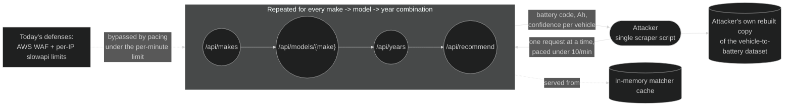

Nothing today stops a script from asking our app about every car we know about, one at a time (`/api/makes` → `/api/models/{make}` → `/api/years` → `/api/recommend`), and quietly copying our entire "which battery fits which car" dataset — the actual product of all the data-cleaning work behind this project. The realistic attacker here isn't a random internet hacker; it's a local competitor in the Kenya/Uganda/Tanzania battery market who'd rather copy our data than clean their own.

Today's only defenses are **AWS WAF** (a traffic filter AWS runs in front of our servers, before requests even reach our code) and **`slowapi`** (our own rate limiter — it counts how many requests each visitor's IP address makes and blocks them once they go over a limit). Both are easy for a patient scraper to get around by spacing requests out or switching IP addresses.

| # | Planned solution | Description | Status |
|---|---|---|---|
| 1 | Daily limits per visitor, backed by Redis | Add a per-day limit on top of the existing per-minute one. **Redis** is a shared, very fast in-memory database all our servers can read/write together — without it, each of our 2+ servers would count separately and a scraper could just get lucky about which one answers. Catches someone who paces requests just under the per-minute limit but keeps going for days. | Planned |
| 2 | Invisible "are you a robot?" check (Google reCAPTCHA v3) on `/api/recommend` | Scores each request quietly in the background — no puzzle, no click — based on how human the visitor's behavior looks, and blocks or challenges the low scores. Turns scraping from "just send more requests" into "pay a CAPTCHA-solving service or run a full browser that fakes being human," which is much more expensive. | Planned |
| 3 | Scanning-pattern detection | Track how many *different* car makes/models each visitor has asked about recently. A real shopper looks up one or two cars; a scraper systematically works through hundreds. Flag or slow down whoever's pattern looks like the second kind. | Planned |

None of the three are implemented yet — WAF and per-IP rate limiting remain the only defenses in the current codebase.

### Threat Model 2 — Distributed Abuse (reviewed 2026-07-18, Not Yet Implemented)

Same extraction walk as Threat Model 1, just spread across many IPs so no single one ever trips a per-IP limit — plus the same botnet spamming `/api/feedback` on the side:

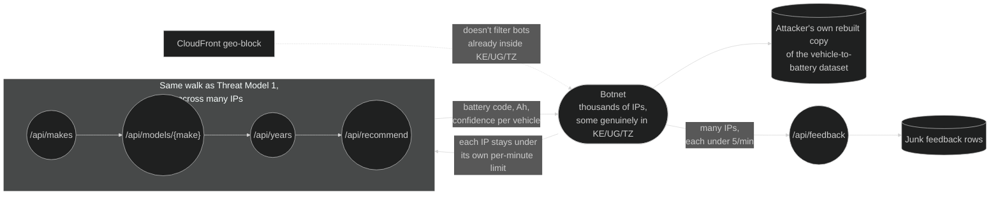

Threat Model 1 assumes one attacker, scripting from one place, that we can eventually recognize and slow down. This one is harder: the same attack, but spread across **thousands of different IP addresses at once** — a "botnet," meaning many separate computers or devices under one attacker's control — including some genuinely located inside Kenya/Uganda/Tanzania, so our geo-block (which only rejects traffic from *outside* those countries) doesn't filter them out. Almost every defense above counts requests *per IP address* — so a large enough botnet just gets a fresh, un-throttled counter for every IP it uses.

| Attack | Today's defense | The gap | Planned fix |
|---|---|---|---|
| Botnet spread across many IPs | Geo-block (rejects traffic from outside KE/UG/TZ only) | Does nothing to bots already inside the region | The reCAPTCHA check (Threat Model 1, item 2) is the one defense above that isn't per-IP — extending it to cover `/api/feedback` too (item 1 below) closes this for both endpoints it reaches |
| General per-IP rate limits (`slowapi`) | Counts requests per IP address | A big enough botnet gets a fresh, unlimited bucket per IP | Not solved by anything currently planned — see item 4 below |
| Database connection-pool overload | No safety switch if the pool fills up | Real, but smaller than it sounds — `/api/recommend` answers entirely from data already loaded in memory, so a traffic spike there barely touches the database | Item 2 below |
| Scanning `/api/makes` / `/api/models` | 20 requests/minute per IP, no response caching | Doesn't actually load the database (see above) — the real risk is the same dataset-copying threat from Threat Model 1 | Already covered by Threat Model 1, items 1 and 3 |
| Feedback spam (`/api/feedback`) | 5 requests/minute per IP | A botnet spread thin enough (many IPs, each under 5/min) can still flood us with junk feedback rows | Item 1 below |
| Unverified AWS WAF rules | WAF is attached to our load balancer | This README can only say WAF is attached — the actual rule configuration lives in AWS, outside this repo, so it can't be verified from the code | Item 3 below (a documentation task, not code) |

| # | Planned solution | Description | Status |
|---|---|---|---|
| 1 | Extend the reCAPTCHA check to `POST /api/feedback` too | The same invisible robot-check from Threat Model 1, item 2, just applied to the feedback form as well. Cheap to add since the integration already exists; closes the botnet gap on both endpoints in one change. | Planned |
| 2 | Database connection-pool **circuit breaker** | A circuit breaker is a safety switch: instead of letting every incoming request pile up and wait when the database connection pool is full, reject new ones quickly with a "try again shortly" response, so the app stays responsive instead of every waiting request timing out together. | Planned |
| 3 | Document the actual AWS WAF rules | Not app code — writing down (or linking to) exactly which WAF rules are configured, so "WAF is attached" is something that can be verified, not just asserted. | Planned (documentation) |
| 4 | Full botnet-grade defense (IP-reputation lists, browser-fingerprint/JS challenges, etc.) | Tools that can tell a real browser from a script even across thousands of different IPs. | **Planned, phased** — see below |

**Item 4, phased.** Rather than one big undertaking, this is staged from cheapest/least-invasive to most:

1. **Enable AWS WAF's Bot Control managed rule group** — AWS's own bot-classification service (TLS/HTTP fingerprinting, known bot signatures, behavioral heuristics), sitting on infrastructure already in place. Not keyed by IP at all, so it doesn't matter how many addresses the botnet spreads across. A WAF rule toggle, not app code.
2. **Enable AWS WAF's Anonymous IP list managed rule group** — flags traffic from known VPNs/proxies/Tor/datacenter hosting ranges. Real customers here are individual shoppers on residential/mobile ISPs in Kenya/Uganda/Tanzania, so traffic from a hosting provider's IP range is already a strong bot signal. Also just a WAF rule toggle.
3. **Escalate reCAPTCHA v3's low scores to an interactive challenge** — items 1–2 in this table's solution list only *score* requests invisibly today; a low score could trigger an actual challenge (checkbox/image puzzle) instead of silently passing through, closing the gap for requests that come back suspicious rather than only blocking the clearly-bad ones.
4. **A lightweight home-grown session token, applied to every public endpoint** (not just `/api/recommend`/`/api/feedback`) — cheap, no vendor, weaker signal than 1–3, but blocks the least-sophisticated scripts for free:
   - When the frontend loads the page, the server issues a random token signed with a server-side secret (HMAC — a symmetric secret, not a public/private key pair; there's no separate issuer/verifier here, the same process does both, so asymmetric crypto would add complexity without adding protection). The signature stops anyone from *forging* a token without knowing the secret.
   - The frontend attaches that token to every subsequent public API call. Requests with no token, an invalid signature, or an expired one are rejected.
   - Signing alone only stops forgery, not a genuinely stolen/copied token being replayed — a captured token would otherwise still look valid however it's protected, since the server can't distinguish a real reuse from a copied one. Three things make a captured token low-value instead: **short expiry** (a few minutes, not hours — a copy stops working almost immediately), **one-time use** (the token is marked spent on first use; a second use, real or replayed, is rejected — forcing a scraper to steal a fresh token *per request*, not once per session), and **`HttpOnly` cookie storage** (same pattern already used for admin sessions — client-side JavaScript, including an XSS payload, can't read it to steal it). Transport is already covered — HTTPS everywhere in this app already prevents interception on the wire, which is the realistic way a token would leak in the first place.
   - Net effect: a bare `curl`/`requests` script that hits API endpoints directly, never loading the actual page, never gets a token at all and is rejected outright. A moderately competent scraper (fetch the page first, then reuse the token) or a real headless browser still gets through — this phase is a cheap tripwire against the laziest scripts, not a replacement for phases 1–3.
5. **A dedicated bot-management vendor (Cloudflare Bot Management, HUMAN/PerimeterX, Akamai) — deferred, not committed.** The most thorough option, purpose-built for this exact problem at scale, but it's a new vendor and likely a bigger infra change (routing traffic through their edge). Disproportionate as a first move — same reasoning the README already uses to reject a general CAPTCHA system for the admin dashboard. Revisit only if phases 1–4 prove insufficient in practice.

### Overall Security Posture After Planned Work

| Threat | Today | After the planned work above ships |
|---|---|---|
| One scraper copying our dataset | Weak — rate limits are easy to pace around | Strong — daily caps + robot-check + scanning detection |
| Botnet across thousands of IPs, on `/api/recommend` or `/api/feedback` | Weak | Better — the robot-check isn't per-IP, so it still catches this |
| Botnet across thousands of IPs, everywhere else | Weak | Better, in phases — WAF Bot Control + Anonymous IP list (item 4, phases 1–2) aren't per-IP or endpoint-specific, so they help broadly; a dedicated bot-management vendor (phase 5) remains deferred, not committed |
| Admin account brute-force login | Strong (already shipped — lockout after 8 failed attempts) | Strong |
| Full battery catalogue export | Strong (requires admin login) | Strong |
| Database overload from a `/api/recommend` traffic spike | Fine already — matching runs from memory, not live database queries | Fine, plus a graceful "try again shortly" instead of requests hanging, once the circuit breaker ships |

### Audit — Frontend / Database Exposure (2026-07-18)

A targeted audit of whether the frontend could be exposing anything about the database — credentials, connection strings, schema/table names, raw SQL, stack traces, or admin-only data reachable without auth. Findings verified independently (a script checked auth coverage across all 81 `admin_router.py` routes; `console.*` usage was grepped directly) rather than taken on faith. Result: **clean** — no exposure found.

- **No secrets in frontend source or the built bundle** — `frontend/src` and every file in `frontend/dist/assets/*.js` grepped for `postgresql://`, `DATABASE_URL`, the DB username/dbname, port `5434`, etc. Zero hits.
- **No Vite env var leakage** — the frontend uses zero `VITE_*` env vars and has no `import.meta.env` usage anywhere in `src`, no `frontend/.env` file, and no source maps are built or served (`build.sourcemap` unset, no `.map` files in `dist`). This matters because Vite bakes any `import.meta.env.VITE_*` value directly into the shipped client bundle at build time — a DB-related variable accidentally given that prefix would otherwise be permanently embedded in public JS.
- **No console logging of errors** — `lib/api.ts`, `lib/adminApi.ts`, and `lib/testUserApi.ts` contain zero `console.*` calls; failures are propagated as thrown exceptions, not logged, so a leaked backend error body could never end up sitting in browser devtools.
- **Public API endpoints don't leak internals** — every public route in `app.py` (`/api/makes`, `/api/models/{make}`, `/api/years`, `/api/recommend`, `/api/batteries/search`, `/api/feedback`, `/api/auth/*`) was checked for a bare `except Exception as e: return {"error": str(e)}` pattern, which would leak a raw SQLAlchemy/psycopg error (these often contain table/column names) to an unauthenticated caller. None exists — every `except Exception` either logs server-side or falls through to a generic, fixed response. `GET /health` returns only `{"status": "ok"/"down"}`, confirming the "Health/readiness endpoint" design note above holds in practice.
- **Every admin route is gated** — all 81 routes in `admin_router.py` require `Depends(require_admin)` except `POST /login` (has to be) and `POST /logout` (correctly needs none — it just clears whatever session cookie is present and returns nothing).
- **No secret was ever committed to git** — `.env` is gitignored and was never tracked; `git log --all --full-history` for `.env`/`*.sql`/`*.dump` is empty, so there's no leftover exposure in history even if this repo were later made public.

One non-issue noted in passing, not a leak: `db-backup-script/backup-db.ps1` (a local ops script, not part of the frontend or API surface) hardcodes the non-secret DB username/dbname (`batteryfinder`/`batteryfinderdev`) as default script parameters — no password.

### Summary

**Verdict: robust against unauthorized access and data theft, not robust against abuse at scale — two different tiers, not a uniform posture.** Authentication, sessions, CSRF, SQL injection, and secret handling are shipped and independently audited, not just asserted (bcrypt cost 12, DB-revocable sessions rather than stateless tokens, `SameSite=Strict`, 100% parameterized queries, zero secrets found in the frontend audit above, all 81 admin routes gated) — a competent attacker trying to break in or steal data directly would not find an easy way through this tier.

Scraping and bot abuse are the opposite story, and this is a live gap today, not a hypothetical one: the only current defenses (AWS WAF's default rules, per-IP `slowapi` limits) are both keyed on IP address, the one dimension a scraper or small botnet can trivially vary. Someone pacing requests under the per-minute limit, or spreading across a handful of rotating IPs, can rebuild the entire vehicle→battery dataset or spam the feedback endpoint right now — and the realistic attacker here isn't hypothetical, it's a local competitor with an ordinary business incentive to do exactly that. A concrete, staged plan exists to close this (Threat Models 1 and 2 above) and none of it requires a redesign, but until it ships, this is the app's genuinely weak point, not a minor one.

**Once every planned item above ships (excluding Threat Model 2 item 4's deferred phase 5):** the classic-attack tier is untouched — it's already strong and nothing in either roadmap changes it. The scraping/abuse tier closes to a genuinely high bar *for the threat this app actually names as realistic* — a local competitor would need to solve CAPTCHAs (or run full browser automation) on every request, stay under both per-minute and daily limits, and avoid tripping enumeration-pattern detection, while separately getting screened by WAF Bot Control and an anonymous-IP blocklist. That's expensive and slow enough to no longer be a shortcut around doing the underlying data-cleaning work themselves — which is the actual bar that matters here, not theoretical perfection. Against a hypothetical, well-resourced attacker running real residential-proxy IPs through full human-mimicking browser automation, the honest answer is: meaningfully harder, but not solved — a dedicated bot-management vendor (the one tool that reliably catches that tier) is explicitly deferred, not shipped, in the current plan. So: **strong across the board for the documented threat model; good but not absolute against a threat actor this app was never scoped to defend against.**

---

## Production Architecture

This reflects the target end state with every currently-planned security item shipped (both Threat Model roadmaps above) — not what's running today. WAF's Bot Control / Anonymous IP list rules, the reCAPTCHA + session-token check, ElastiCache Redis actually being used for rate caps (it's provisioned but idle today), and the connection-pool circuit breaker are all still items on those roadmaps, not live yet.

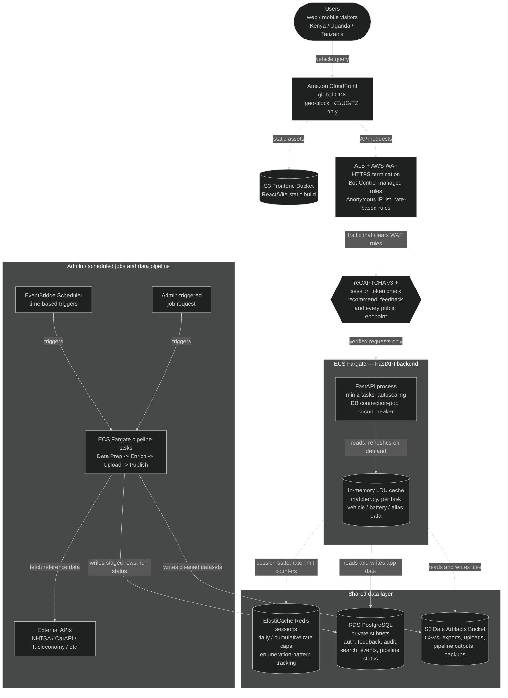

Every AWS resource is now drawn exactly once, even where both the request path and the pipeline touch it — `RDS` and `S3D` are the same nodes referenced from both `ECSBOX` and `PIPE`, not separate look-alike boxes for "the app's copy" and "the pipeline's copy." Every edge is single-direction and labeled with what actually flows and why, rather than a `<-->` standing in for "these two things talk to each other somehow." `LRU` is nested inside the `ECSBOX` subgraph rather than floating next to it, since it lives inside the FastAPI process, not beside it as a peer service — every edge leaving `ECSBOX` starts from the subgraph boundary itself, not from a specific node inside it.

The **In-memory LRU cache** inside each ECS Fargate task is distinct from **ElastiCache Redis** — the LRU cache is a per-process Python object (`@lru_cache` in `matcher.py`, see [Performance](#performance) and [In-memory cache isolation](#security)) holding vehicle/battery/alias data with zero network hops, while Redis is a shared service every task talks to over the network for state that genuinely needs to be consistent *across* tasks (sessions, rate-limit counters, enumeration tracking) — the LRU cache can't do that job since each task's copy is independent.

Secrets are stored in AWS SSM Parameter Store or Secrets Manager and injected as environment variables at task runtime.

Docker is not part of this production path — ECS Fargate runs the FastAPI backend directly, and RDS is a managed Postgres instance, not a container. Docker is only used locally (see [Local Postgres (Docker)](#local-postgres-docker)), running the same PostgreSQL 15 engine version as RDS so migrations and queries behave identically before they ever reach production.

---

## Environment Variables

Create a `.env` file at the repo root and fill in your values before running the app:

| Variable | Required | Description |
|---|---|---|
| `DATABASE_URL` | Yes | PostgreSQL connection string for the full-privilege `batteryfinder` role. Matches `docker-compose.yml`'s Postgres service by default — see [Local Postgres (Docker)](#local-postgres-docker) |
| `PUBLIC_DATABASE_URL` | Yes | PostgreSQL connection string for the restricted `batteryfinder_public` role used by public routes (`app.py`) and `matcher.py`. Same host/db as `DATABASE_URL`, different user/password. Create the role first by running migration `20260721_c4d5e6f7a8b9` with `PUBLIC_DB_PASSWORD` set (see below) |
| `PUBLIC_DB_PASSWORD` | Only when running migration `20260721_c4d5e6f7a8b9` | Password to (re-)create the `batteryfinder_public` role with. Only read at migration time, not by the running app — not needed once the role exists and `PUBLIC_DATABASE_URL` is set |
| `ADMIN_COOKIE_SECURE` | No | Set `false` for local HTTP dev (default `true`); also gates the `Strict-Transport-Security` response header |
| `ALLOWED_ORIGINS` | No | Comma-separated list of origins allowed to make cross-origin requests (CORS). Empty by default — CloudFront/ALB serve the SPA and API same-origin in production, so no origin is trusted unless explicitly set here |
| `SEARXNG_URL` | No | SearXNG instance base URL for web battery validation; skipped if unset |
| `BRAVE_SEARCH_API_KEY` | No | Brave Search API key for web battery validation; skipped if unset |
| `BRAVE_MONTHLY_QUOTA` | No | Override Brave's monthly call quota (default 2000) |
| `TAVILY_API_KEY` | No | Tavily API key for web battery validation; skipped if unset |
| `TAVILY_MONTHLY_QUOTA` | No | Override Tavily's monthly call quota (default 1000) |

Example `.env`:

```env
DATABASE_URL=postgresql://******
PUBLIC_DATABASE_URL=postgresql://******
ADMIN_COOKIE_SECURE=false
```

> **Never commit `.env` to version control.** The repository `.gitignore` already excludes it.

---

## Automated Test Suite

### Backend (`backend/tests/`, pytest — 62 tests)

`conftest.py` wires a minimal FastAPI app around `admin_router`'s routes against the real local Docker Postgres. Each test runs inside a transaction that's rolled back afterward, so DB writes never persist — **but this only covers database operations**, not filesystem side effects (e.g. a route that deletes a cache file on disk); tests touching those need to mock the filesystem call directly rather than relying on rollback.

```bash
cd backend
pytest                              # run everything
pytest --junitxml=test-results.xml  # what CI runs, for a JUnit report
```

| File | Tests | Covers |
| --- | --- | --- |
| `test_matcher.py` | 31 | The matching engine itself: model-name/fuel normalization, Ah-bracket sizing, battery-technology preference rules (luxury→AGM, EV→MF, hybrid→EFB, stop-start/diesel combinations), NS/JIS vs DIN region rules, all 3 layers of `recommend()` (exact, soft, fallback), JDM alias resolution, year-window/tie-break edge cases, and the per-make `_make_index` cache |
| `test_admin_battery_crud.py` | 8 | Battery catalogue CRUD edge cases — duplicate codes, not-found updates/deletes, soft-delete exclusion from listings, reusing a soft-deleted battery's code |
| `test_admin_crsp_pipeline.py` | 7 | CRSP vehicle-data staging lifecycle — conflict/new filters, commit (add vs. skip-existing), discard, revert-by-version |
| `test_admin_web_validate_pipeline.py` | 7 | Concurrency guards on the web-validation pipeline — blocking a new run while one is paused/running, guarding reset-cache/commit/discard the same way |
| `test_web_validate_staging_and_quota.py` | 7 | The web-validation staging→master handoff (added vs. updated labeling, invalid-row removal, conflict resolution, discard never touching master) and the atomic quota-reservation fix under concurrency |
| `test_admin_health.py` | 1 | Admin health endpoint reports the true cluster-wide DB connection count, not just one ECS task's local pool |
| `test_health_endpoint.py` | 1 | Public unauthenticated `/health` returns only a minimal `{"status": "ok"}` body |

### Frontend (`frontend/src/**/*.test.{ts,tsx}`, Vitest + React Testing Library — 169 tests)

`vitest.config.ts` runs in a jsdom environment with `src/test/setup.ts` as the global setup (jest-dom matchers, a `matchMedia` polyfill jsdom doesn't provide). Two stability fixes worth knowing about if you're adding tests here: `process.env.NODE_ENV` is forced to `"test"` in the config (an ambient `NODE_ENV=production` left over from a build step makes React resolve its production bundle inside jsdom, which breaks `act()`), and `fileParallelism: false` plus a raised `configure({ asyncUtilTimeout: 5000 })` are both set because running every file's jsdom instance fully in parallel produced real, reproducible `waitFor` timeouts on this machine — correctness over raw speed for a CI-run suite. Test files are excluded from `tsconfig.app.json`'s `tsc -b` (so `bun run build` never fails on test-only globals) and get their own `tsconfig.test.json` for editor support instead.

Several components render unlabeled `<input>`s (no `htmlFor`/`id` pairing between `<label>` and its input — a real accessibility gap, not fixed here since that's out of scope for writing tests) — those tests select fields by DOM order/type rather than `getByLabelText`; see `AdminLogin.test.tsx` and `AdminBatteries.test.tsx` for the pattern.

```bash
cd frontend
bun run test                              # run everything
bun run test:ci                           # what CI runs — adds a JUnit report (test-results.xml)
```

| File | Tests | Covers |
| --- | --- | --- |
| `lib/utils.test.ts` | 7 | `cn()`'s tailwind-conflict merging, `stripMakePrefix()`'s prefix matching, `useIsMobile()`'s initial state and matchMedia reactivity |
| `lib/brandBranding.test.ts` | 10 | `resolveDisplayBrand()`'s brand/technology branching (Exide Maxx detection, Chloride Exide / Exide Matrix technology splits) and `groupByBrand()`'s counting/sort order |
| `lib/maintenance.test.ts` | 5 | 503+HTML maintenance-mode detection vs. an ordinary API error, and the reload-and-throw redirect |
| `lib/api.test.ts` | 23 | `friendlyError()`'s full branch coverage, the public fetch wrappers' request shape/query-encoding, error-detail propagation, and the maintenance-mode path |
| `lib/testUserApi.test.ts` | 13 | Token/cached-user localStorage helpers, register/login/logout/`fetchMe`'s token lifecycle including the 401-clears-token path |
| `lib/adminApi.test.ts` | 27 | `adminFetch()`'s shared branching (401/5xx/4xx/network-failure/204), `friendlyErrorMessage()`'s status mapping, representative wrapper request shapes, and the two non-`adminFetch` paths (`uploadBatteriesExcel`'s FormData, `downloadFeedbackPdf/Csv`'s blob-to-download flow) |
| `lib/TestUserContext.test.tsx` | 4 | `TestUserProvider`'s no-token fast path, loading→resolved transition, fetchMe-failure fallback, and `logout()` |
| `components/AccuracyBar.test.tsx` | 6 | The accuracy-score calculation driven through rendered output (exact/close/fallback match types) and the compact-mode tooltip toggle |
| `components/ConfidenceBar.test.tsx` | 4 | The displayed percentage and its three confidence-tier color classes |
| `components/VehicleFinderForm.test.tsx` | 5 | The core select-mode search flow: make→model→year cascade, a successful submission rendering the result card, and both a failed recommendation and a failed initial makes-fetch surfacing inline |
| `components/admin/ProtectedRoute.test.tsx` | 4 | The loading/ok/unauth/unreachable state machine, including that an unreachable backend shows a retry screen rather than bouncing to login |
| `components/admin/AdminLayout.test.tsx` | 6 | Active-route nav highlighting, auto-collapse on certain routes, dark-mode/collapse persistence to localStorage, and sign-out |
| `pages/admin/AdminLogin.test.tsx` | 3 | Login→navigate on success, inline error with no navigation on failure, disabled/"Signing in…" while in flight |
| `pages/admin/AdminSessions.test.tsx` | 5 | Active/expired counts, empty state, `AdminAuthError` redirect vs. a plain load error, and revoking a session |
| `pages/admin/AdminSettings.test.tsx` | 5 | Maintenance-mode ON/OFF button and status text, the visitor-facing banner, a successful and a failed toggle, and the load-failure path |
| `pages/admin/AdminTestSessions.test.tsx` | 5 | Combined session+user load, the active-session-count chip, empty state, the Users tab, and revoking a session |
| `pages/admin/AdminSearchLog.test.tsx` | 5 | Row rendering, empty/error states, pagination, and the PDF button's disabled-when-empty state |
| `pages/admin/AdminAuditLog.test.tsx` | 7 | Entry rendering with the computed changed-field count, empty/error states, the diff-viewer expand/collapse, action-filter apply/reset, and pagination |
| `pages/admin/AdminFeedback.test.tsx` | 6 | Summary strip + row rendering, empty/error states, the accuracy filter (reloading page 1, hiding the summary strip), CSV export, and pagination |
| `pages/admin/AdminBatteries.test.tsx` | 7 | Overview brand grouping by origin, brand-tile drill-down, the manage-mode paginated table, adding a battery (verifying the uppercase/trim normalization), and delete confirm/cancel via `window.confirm` |
| `pages/admin/AdminVehicleData.test.tsx` | 6 | Coverage tab's matched-percentage display, the staleness banner, coverage-by-make search filtering, a load failure, and the OEM Fitment tab |
| `pages/admin/AdminDashboard.test.tsx` | 5 | All-four-source load rendering stats/health, a load failure, "Refresh now" re-triggering all fetches, and the cache-refresh success/failure messages |
| `test/smoke.test.tsx` | 1 | Proves the Vitest + RTL + jsdom pipeline itself renders and asserts correctly |

**Not covered, flagged as follow-up work, not silently assumed away:**

- `AdminDataPipeline.tsx` (4,395 lines — three pipeline UIs bundled into one file: CRSP, web-validation, vehicle expansion) is large enough to deserve its own dedicated test-writing pass rather than being squeezed into this one.
- `VehicleFinderForm.tsx`/`MobileVehicleFinder.tsx`'s type-mode search, battery-spec search tab, alternates list, copy-to-clipboard, and the feedback modal — only the main select-mode search+result flow is covered.
- Every modal component (`FeedbackModal`, `FaqModal`, `HowToUseModal`, `PrivacyModal`, `CopyrightModal`, `TermsGate`, `BuildVersionModal`) and `pages/TestUserLogin.tsx` have no tests yet.

## CI/CD

Defined in `Jenkinsfile`. Pipeline stages:

1. Checkout source
2. Install Python dependencies (`pip install -r backend/requirements.txt`)
3. Install Bun + frontend dependencies (`bun install`)
4. Frontend lint (`bun run lint`)
5. Frontend build (`bun run build`)
6. Frontend tests (`bun run test:ci` — Vitest with a JUnit report) — see [Automated Test Suite](#automated-test-suite) above
7. Start test database — brings up the same Postgres 15 container `docker-compose.yml` defines for local dev, migrates it to head (`alembic upgrade head`)
8. Backend tests (`pytest --junitxml=test-results.xml`) — see [Automated Test Suite](#automated-test-suite) above
9. Archive `frontend/dist/` artifacts

Both suites' JUnit reports are published via the same post-build step (`junit testResults: '**/test-results.xml'`, `allowEmptyResults: true` so a missing report doesn't itself fail the build); the Docker test database is torn down in `post { always { ... } }` regardless of outcome. Build failure notifications are sent by email.

### Local Postgres Dev DB Backup (`db-backup-script/`)

On-demand PowerShell scripts for dumping/restoring the local Docker dev database — e.g. to move data to another work computer. Run locally, no Jenkins job required (this replaces the old `Jenkinsfile.db-backup` pipeline).

**Backup** (`db-backup-script/backup-db.ps1`):

1. Verifies the `battery-finder-postgres` container is running
2. `pg_dump`s the `batteryfinderdev` database inside the container to a timestamped custom-format (`-F c`) file
3. Copies the dump out of the container into `backups/` at the repo root
4. Prunes old dumps, keeping only the newest 10 by default

```powershell
powershell -File db-backup-script/backup-db.ps1
powershell -File db-backup-script/backup-db.ps1 -KeepCount 20   # keep more than the default 10
```

**Restore** (`db-backup-script/restore-db.ps1`) — copies a dump into the container and `pg_restore`s it with `--clean --if-exists`, overwriting the target database's contents:

```powershell
# drop a .dump file into db-restore/, then run with no args — restores the newest one found there, after a confirmation prompt
powershell -File db-backup-script/restore-db.ps1

# or restore a specific file from anywhere (e.g. a dump from backups/)
powershell -File db-backup-script/restore-db.ps1 -DumpFile backups\batteryfinderdev_20260708_082639.dump

# skip the confirmation prompt
powershell -File db-backup-script/restore-db.ps1 -DumpFile path\to\some.dump -Force
```
